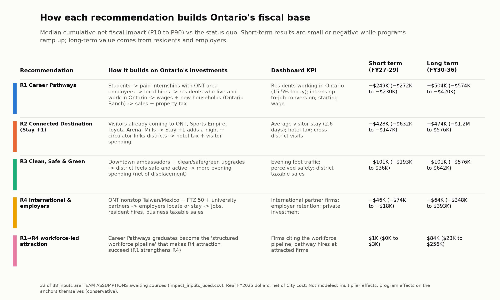

<a id="readme-top"></a>


<br />
<div align="center">
  <h2 align="center">Connecting Ontario: Forecast &amp; Impact Model</h2>
  <p align="center">
    How our recommendations build on what the City of Ontario, CA already has (the airport, Sports Empire,
    Toyota Arena, Downtown, Ontario Ranch) to grow local jobs, visitor stays and the City's tax base.
    <br />
    <em>Sunstone Economic Development Challenge @ USC Price</em>
    <br /><br />
    <a href="docs/conclusions.md"><strong>Read the conclusions »</strong></a>
    ·
    <a href="reports/final/">Browse the charts</a>
    ·
    <a href="#quick-start">Run it yourself</a>
  </p>
</div>

<details>
  <summary>Table of Contents</summary>
  <ol>
    <li><a href="#at-a-glance">At a glance</a></li>
    <li><a href="#documentation">Documentation</a></li>
    <li><a href="#quick-start">Quick start</a></li>
    <li><a href="#built-with">Built with</a></li>
    <li><a href="#roadmap">Roadmap</a></li>
    <li><a href="#contact">Contact</a></li>
    <li><a href="#acknowledgments">Acknowledgments</a></li>
  </ol>
</details>

## At a glance

| Code | Recommendation | In one sentence |
|---|---|---|
| **R1** | Career Pathways & Employer Consortium | Connect students to paid internships with Ontario employers so more residents live *and* work here |
| **R2** | Connected Destination (Stay +1) | Turn visitors who already come for the airport, games and shopping into overnight guests |
| **R3** | Clean, Safe & Green Districts | Make Downtown feel safe and lively in the evening so people stay and spend |
| **R4** | International & employer attraction | Use ONT's Taiwan/Mexico flights and the trade zone to attract and keep employers |
| **R1→R4** | The link between them | A ready local workforce (R1) makes employers easier to attract (R4) |

[](docs/conclusions.md)

> **Preliminary:** most program inputs are still team estimates. The ranking of the findings is meaningful
> now; the exact dollar figures will change as inputs are sourced.

- **The plan is well designed:** it builds on existing City investments, keeps Year 1 City cost
  at about **$348K (cap $500K)**, and expands only when results justify it.
- **In tax revenue alone it returns about $0.76 per $1 of City money**, so its case rests on residents,
  workforce and partners sharing costs.
- **Best combination:** Stay +1 (R2) and Clean, Safe & Green (R3) as the near-term core, with Career Pathways (R1)
  run lean as the engine for employer attraction (R4). **Employer attraction backed by Career Pathways returns
  $1.11 per $1**, the only group that pays for itself in the median case.
- **The number to measure first:** Stay +1 uptake. At about **3.5%** of overnight visitors, Stay +1 pays for itself.

<p align="right">(<a href="#readme-top">back to top</a>)</p>

## Documentation

| | Document | What's in it |
|---|---|---|
| 1 | **[Background](docs/background.md)** | The Sunstone challenge and our client. Ontario's problem: only ~15.5% of working residents work locally, visitors pass through, and businesses cite safety and cost. Also the four recommendations and what this project sets out to test. |
| 2 | **[Decisions](docs/decisions.md)** | How the team's pre-forecast research (commute data, wage data, asset review, business survey, budget) shaped the model. Why each data source was chosen (official sources first). The modeling and engineering choices, with the alternatives we rejected. |
| 3 | **[Methods](docs/methods.md)** | The full data engineering pipeline (dlt → DuckDB SQL → quality checks → Nx) and the data science: exploratory analysis, baseline model selection, likely-range scenarios, and an impact formula for each recommendation, plus ROI, sensitivity and limitations. |
| 4 | **[Conclusions](docs/conclusions.md)** | Results with charts: the status-quo forecasts, short- and long-term impact per recommendation, return per $1 and break-even City cost, which City investments carry the most value, what drives the answer, and how the model judges each recommendation's success. |

<p align="right">(<a href="#readme-top">back to top</a>)</p>

## Quick start

**Prerequisites:** `brew install uv node pnpm`. Optional free API keys go in `.dlt/secrets.toml`
(`census_api_key`, `bls_api_key`); see [Methods](docs/methods.md#a2-ingestion-srcontario_forecastingest).

```bash
uv sync --all-extras && pnpm install && uv run pre-commit install
```

| Goal | Command |
|---|---|
| Lint + tests (cached) | `pnpm nx run-many -t lint test` |
| Rebuild every chart from data already loaded | `pnpm nx run ontario-forecast:report` |
| End to end: checks → fresh data → every chart | `pnpm nx run ontario-forecast:e2e` |
| Load commuting data (LODES, once) | `pnpm nx run ontario-forecast:ingest-lodes` |
| Add a new analysis step | `pnpm nx g @sunstone/pipeline-plugin:stage <name> --dependsOn=select` |
| See the pipeline graph | `pnpm nx graph` |

**PyCharm:** use `.venv/bin/python` as the interpreter and mark `src` as Sources Root.

<p align="right">(<a href="#readme-top">back to top</a>)</p>

## Built with

[Python](https://www.python.org/) + [uv](https://docs.astral.sh/uv/) ·
[dlt](https://dlthub.com/) · [DuckDB](https://duckdb.org/) ·
[statsmodels](https://www.statsmodels.org/) + [SciPy](https://scipy.org/) + numpy ·
[matplotlib](https://matplotlib.org/) · [Nx](https://nx.dev/) + [pnpm](https://pnpm.io/) ·
[ruff](https://docs.astral.sh/ruff/), [pre-commit](https://pre-commit.com/), [pytest](https://pytest.org/)

## Roadmap

- [x] Public-data pipeline with data-quality checks
- [x] Status-quo forecasts and the recommendation impact model, including ROI
- [x] Nx orchestration + stage generator
- [ ] Source the five highest-impact inputs (Stay +1 uptake, Downtown uplift and share, R2 cost, R2 additionality)
- [ ] Add the City's adopted FY2026–27 budget to `data/manual/city_budget_revenue.csv`
- [ ] Load LODES and ACS for the live/work charts
- [ ] Reconcile the proposal's $216.3M sales-tax figure with State Controller actuals (~$139M)

## Contact

Danny Valencia · Haley Chavez · Emily Schoof · Nathaniel Gallardo
(USC Price, Sunstone Economic Development Challenge), for the City of Ontario Economic Development Agency.

No license has been chosen yet, so all rights are reserved. Choose one before making the repository public.

## Acknowledgments

Data: [CA State Controller](https://bythenumbers.sco.ca.gov/), [CA EDD](https://data.ca.gov/),
[U.S. BLS](https://www.bls.gov/), [U.S. Census Bureau](https://lehd.ces.census.gov/).
README structure: [Best-README-Template](https://github.com/othneildrew/Best-README-Template).

<p align="right">(<a href="#readme-top">back to top</a>)</p>
