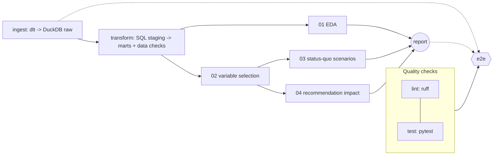

<a id="readme-top"></a>

<!-- PROJECT SHIELDS -->


<br />
<div align="center">
  <h2 align="center">Connecting Ontario: Forecast &amp; Impact Model</h2>

  <p align="center">
    How our recommendations build on what the City of Ontario, CA already has (the airport,
    Sports Empire, Toyota Arena, Downtown, Ontario Ranch) to grow jobs for residents, visitor
    stays and the City's tax base, in the short and long term.
    <br />
    <em>Sunstone Economic Development Challenge @ USC Price</em>
    <br />
    <br />
    <a href="#what-we-found"><strong>See the findings »</strong></a>
    ·
    <a href="reports/final/">Browse the charts</a>
    ·
    <a href="#getting-started">Run it yourself</a>
  </p>
</div>

<!-- TABLE OF CONTENTS -->
<details>
  <summary>Table of Contents</summary>
  <ol>
    <li><a href="#about-the-project">About the project</a>
      <ul>
        <li><a href="#what-we-found">What we found</a></li>
        <li><a href="#how-to-read-the-charts">How to read the charts</a></li>
        <li><a href="#built-with">Built with</a></li>
      </ul>
    </li>
    <li><a href="#getting-started">Getting started</a></li>
    <li><a href="#usage">Usage</a></li>
    <li><a href="#how-it-works">How it works (technical)</a></li>
    <li><a href="#roadmap">Roadmap</a></li>
    <li><a href="#contributing">Contributing</a></li>
    <li><a href="#license">License</a></li>
    <li><a href="#contact">Contact</a></li>
    <li><a href="#acknowledgments">Acknowledgments</a></li>
  </ol>
</details>

---

## About the project

Ontario already has a large economy: Ontario International Airport (ONT), Ontario Mills, Toyota Arena,
the Sports Empire and one of Southern California's largest logistics hubs. But **only about 15.5% of
working residents work in Ontario**, and visitors often leave the same day.

Our proposal makes four recommendations. This project measures what each one could add, **on top of
what would happen anyway**:

| | Recommendation | In one sentence |
|---|---|---|
| 🎓 | **R1 Career Pathways** | Connect students to paid internships with Ontario employers so more residents live *and* work here. |
| 🏨 | **R2 Connected Destination (Stay +1)** | Turn visitors who already come for the airport, games and shopping into overnight guests. |
| 🌳 | **R3 Clean, Safe & Green** | Make Downtown feel safe and lively in the evening so people stay and spend. |
| 🌏 | **R4 International & Employers** | Use ONT's Taiwan/Mexico flights and the trade zone to attract and keep employers. |
| 🔗 | **R1 → R4 together** | A ready local workforce (R1) makes employers easier to attract (R4). |

[![How each recommendation builds Ontario's fiscal base][pathway-chart]](reports/final/impact_pathways.png)

<p align="right">(<a href="#readme-top">back to top</a>)</p>

### What we found

> **Preliminary.** 32 of the model's 38 inputs are still team estimates waiting for an official
> source (see [Roadmap](#roadmap)). The direction of the findings is useful now; the exact dollar
> figures will change as those inputs are sourced.

**1. If nothing changes (the baseline)**
- **Hotel tax** is best predicted by the growth of transportation and warehousing jobs in the region. That
  forecast beat a simple "same as last year" guess by about 12% in normal years.
- **Sales tax:** no regional indicator predicted it better than "same as last year." That's a real
  finding: the City's sales tax follows its own momentum more than the regional economy.

**2. What the recommendations add**
- **Short term (FY27–29):** the City spends before the programs pay back. The median net is about
  **−$0.8M** (likely range −$1.0M to −$0.5M), after partners' contributions.
- **Long term (FY30–36):** still about **−$0.9M** in the median case, but the range now reaches
  **+$0.5M**. The result depends on a few numbers we can measure in Phase 1.
- **People:** by FY2036 about **117 more Ontario residents work in Ontario** (likely 68–198), and about
  **145 more people live here**, through Career Pathways hires and employers they help attract.
- **The airport matters most for Stay +1:** ONT visitors produce more Stay +1 revenue than any other venue.

**3. What this means for the proposal**
- In tax revenue alone, the programs don't pay for themselves under today's cautious assumptions. Their case
  rests on **residents getting local, higher-wage jobs** and on **partners sharing costs**, as the proposal
  already plans.
- **One number matters most:** the share of overnight visitors who book a Stay +1 night. Moving it from
  2% to 5% shifts the long-term result by about $1.7M, more than any other input. The Phase 1 pilot should
  measure it first.
- **Workforce-led attraction (R1→R4)** is the only piece that is positive in every scenario. That supports the
  proposal's central argument that Career Pathways makes business attraction work.

<p align="right">(<a href="#readme-top">back to top</a>)</p>

### How to read the charts

All final charts are in [`reports/final/`](reports/final/) as PNG, SVG and PDF, with a CSV of every number.

| Chart | Question it answers |
|---|---|
| `impact_pathways` | How does each recommendation work, and what is it worth short- and long-term? |
| `impact_annual_net` | Year by year, when does each recommendation cost or earn money? |
| `impact_short_vs_long` | Which recommendations pay off later rather than sooner? |
| `impact_hotel_tax` | How much does Stay +1 change hotel tax compared with doing nothing? |
| `impact_investment_leverage` | Which City investments (airport, Sports Empire, Downtown…) does our plan build on most? |
| `impact_sensitivity` | Which unknown numbers should we pin down first? |
| `*_scenarios` | If nothing changes, what are the low / likely / high outcomes for the next five years? |

- **Three outcomes:** *Downside* means only 1 in 10 simulated futures is worse. *Central* is the middle
  outcome. *Upside* means only 1 in 10 is better.
- **Shaded bands** show the likely range. Where the "with recommendations" band overlaps the "status quo"
  band, the effect is smaller than the normal year-to-year swings.
- All dollars are in **FY2025 dollars**, so inflation doesn't make the numbers look bigger.

<p align="right">(<a href="#readme-top">back to top</a>)</p>

### Built with

* [Python 3.11](https://www.python.org/) managed with [uv](https://docs.astral.sh/uv/)
* [dlt](https://dlthub.com/) to load public data → [DuckDB](https://duckdb.org/) as the local warehouse
* [statsmodels](https://www.statsmodels.org/) and [SciPy](https://scipy.org/) for statistics; numpy for simulation
* [matplotlib](https://matplotlib.org/) for charts
* [Nx](https://nx.dev/) with [pnpm](https://pnpm.io/) to run the pipeline as a dependency graph
* [ruff](https://docs.astral.sh/ruff/), [pre-commit](https://pre-commit.com/) and [pytest](https://pytest.org/) for quality checks

<p align="right">(<a href="#readme-top">back to top</a>)</p>

---

## Getting started

### Prerequisites

* **uv** (Python): `brew install uv`
* **Node 18+ and pnpm** (orchestration): `brew install node pnpm`
* Optional free API keys, stored in `.dlt/secrets.toml` (never committed):
  ```toml
  census_api_key = "..."   # https://api.census.gov/data/key_signup.html  (ACS; skipped if absent)
  bls_api_key = "..."      # https://data.bls.gov/registrationEngine/     (raises the BLS daily limit)
  ```

### Installation

1. Clone the repo
   ```bash
   git clone https://github.com/<your-account>/sunstone-ontario-forecast.git
   cd sunstone-ontario-forecast
   ```
2. Install Python and Node dependencies
   ```bash
   uv sync --all-extras
   pnpm install
   ```
3. Turn on the automatic checks for every commit
   ```bash
   uv run pre-commit install
   ```
4. **PyCharm:** Settings → Python Interpreter → Add → *Existing* → `.venv/bin/python`, then mark `src` as Sources Root.

<p align="right">(<a href="#readme-top">back to top</a>)</p>

## Usage

| Goal | Command |
|---|---|
| Run lint + tests (cached; instant if nothing changed) | `pnpm nx run-many -t lint test` |
| Rebuild every chart from the data already loaded | `pnpm nx run ontario-forecast:report` |
| **End to end:** checks → fresh data pull → every chart | `pnpm nx run ontario-forecast:e2e` |
| One step, e.g. the impact model | `pnpm nx run ontario-forecast:impact` |
| Load commuting data (LODES, ~2 GB streamed, once) | `pnpm nx run ontario-forecast:ingest-lodes` |
| See the pipeline graph | `pnpm nx graph` |

**Add a new analysis step with the generator.** For example, to add an airport-passenger analysis
that runs after model selection:

```bash
pnpm nx g @sunstone/pipeline-plugin:stage airport_passengers --dependsOn=select --description="ONT passenger trends"
```

This creates `analysis/05_airport_passengers.py` from a template that follows the project's conventions.
It also adds the `airport_passengers` target in the right place in the graph (so `report` and `e2e` include it)
and creates `tests/test_airport_passengers.py`.

<details>
  <summary>Without Nx (plain commands)</summary>

```bash
uv run python -m ontario_forecast.ingest.run --skip-lodes          # load public data
uv run python -m ontario_forecast.ingest.run --only lodes_ontario_flows   # optional, ~2 GB streamed
uv run python -m ontario_forecast.transform.run                    # build tables + data checks
uv run python analysis/01_eda.py                                   # exploratory analysis
uv run python analysis/02_variable_selection.py                    # pick forecast models
uv run python analysis/03_scenarios.py                             # status-quo outcomes
uv run python analysis/04_impact.py                                # recommendation impact
uv run pytest
```
</details>

<p align="right">(<a href="#readme-top">back to top</a>)</p>

---

## How it works

### Pipeline



### Data sources

| Source | What it tells us | Table | Coverage |
|---|---|---|---|
| CA State Controller, City Revenues | Ontario's actual hotel tax, sales tax and population (+10 nearby cities) | `raw.sco_city_revenue_lines` | FY2003+ |
| CA EDD LAUS | Ontario's labor force and unemployment | `raw.laus_city_monthly` | ~2010+ |
| BLS API (CES, LAUS, CPI) | Regional jobs by sector, unemployment, inflation | `raw.bls_observations` | 1990+ |
| BLS QCEW | County jobs and pay by industry | `raw.qcew_county_annual` | 2014+ |
| BLS OEWS | Regional wages for the proposal's career-pathway jobs | `raw.oews_msa_occupations` | latest |
| Census LODES 8 | Where residents work and where workers live (the 15.5%) | `raw.lodes_ontario_flows` | 2002+ |
| Census ACS 5-year (key) | Commuting, education, income | `raw.acs_place` | 2010+ |
| Team-entered CSVs | City budget, airport traffic, impact inputs, venue visitors | `raw.manual_<file>` | `data/manual/` |

**Official sources come first.** State Controller, Census, BLS or City budget values always win. A number
quoted in the proposal is used only when no official value exists, and it's flagged (`marts.headline_metrics`).

### Statistical guardrails

- **Fiscal years** run July–June. Monthly data is averaged per fiscal year, and partial years are dropped.
- **Data fixes:** the hotel-tax line rename (FY2017) and the sales-tax "triple flip" (FY2005–16) are corrected
  in SQL, and all dollars are inflation-adjusted with the Los Angeles-area CPI.
- **Few years of data (~20):** each model gets at most one predictor, chosen from 6 named in advance.
  Models use growth rates rather than levels, to avoid false correlations from shared trends.
- **No peeking ahead:** predictors use last year's values. Models are tested only on years they didn't see.
  Each model is compared with "same as last year" on the same years and must beat it to be used.
- **COVID:** FY2020–23 are kept out of model fitting and scored separately.
- **Uncertainty:** ranges come from how wrong each model actually was on unseen years
  (20,000 simulated futures, fixed seed).
- **Impact model:** counts only effects that wouldn't have happened anyway, nets out displacement, includes
  City cost, and excludes multiplier effects, so it errs on the cautious side.
- **Why not machine learning or neural networks:** about 20 annual data points is far too few. Extra
  flexibility would just fit noise.

### Recommendation impact model

| | Builds on | Chain of effects (each step is an input in `data/manual/impact_assumptions.csv`) | Pays through |
|---|---|---|---|
| R1 | Employers at ONT/HUB@ONT, Chaffey, Cal Poly Pomona, CSUSB, Ontario Ranch | interns → hires (only the additional ones) → residents working locally → wages + new households | sales + property tax |
| R2 | ONT, Sports Empire, Toyota Arena, Mills, West Valley Connector | venue visitors × overnight share × Stay +1 uptake → extra nights | hotel + sales tax |
| R3 | Downtown, DOIA | district sales × uplift × share not shifted from elsewhere in Ontario | sales tax |
| R4 | ONT Taiwan/Mexico flights, FTZ 50 | firms × jobs × share attributable to the program → resident hires + business sales | sales + property tax |
| R1→R4 | The Career Pathways workforce | last year's Career Pathways workforce → additional firms | sales + property tax |

Each input has a low/likely/high range, a unit, a **status** (`official`, `proposal` or `assumption`)
and a **source**. `reports/final/impact_inputs_used.csv` lists every value the latest run used.

### Project layout

```
src/ontario_forecast/
  config.py            single source of truth: paths, places, series IDs, COVID years, targets
  ingest/              dlt sources (sources.py), LODES aggregation in DuckDB (lodes.py), CLI (run.py)
  transform/           SQL staging -> marts, data checks, parameter tables, exports
  db.py                SQL -> numpy arrays
  stats.py             statsmodels/scipy wrappers (targeted imports only)
  features.py          shared lag + COVID rules
  evaluation.py        chronological backtest, error metrics, forecast ranges (numpy)
  model.py             deployable forecaster (numpy + json only)
  scenarios.py         P10/P50/P90 simulation
  impact.py            recommendation impact model
  charts.py, reporting.py   chart style and exports
analysis/              01 EDA · 02 variable selection · 03 scenarios · 04 impact
tools/pipeline-plugin/ Nx generator for new analysis stages
tests/                 pytest (stats, SQL, sources, scenarios, impact)
data/manual/           team-entered, cited inputs (tracked in git)
reports/final/         deliverable charts + CSVs (tracked in git)
```

<p align="right">(<a href="#readme-top">back to top</a>)</p>

---

## Roadmap

- [x] Public-data pipeline (State Controller, BLS, EDD, Census) with data-quality checks
- [x] Status-quo forecasts with low / likely / high outcomes
- [x] Recommendation impact model with short- and long-term results
- [x] Nx orchestration + generator for new analysis stages
- [ ] Replace the highest-impact team assumptions with sourced values (ranked in `impact_sensitivity`):
  - [ ] Stay +1 uptake (Phase 1 pilot data)
  - [ ] Downtown share of citywide sales and expected uplift (CDTFA/HdL; BID evaluations)
  - [ ] Ontario TOT rate (Municipal Code) and average room rate (STR / CVB)
- [ ] Fill `data/manual/city_budget_revenue.csv` from the adopted FY2026–27 budget
- [ ] Load LODES (commuting) and ACS (Census key) for the live/work charts
- [ ] Add Convention Center visitor counts to `anchor_visitors.csv`
- [ ] Reconcile the proposal's $216.3M sales-tax figure with State Controller actuals (~$139M)

<p align="right">(<a href="#readme-top">back to top</a>)</p>

## Contributing

1. Create a branch (`git checkout -b feature/short-name`).
2. Make the change. For a new analysis step, use the generator (see [Usage](#usage)).
3. Run `pnpm nx run-many -t lint test`. Pre-commit runs the same checks on every commit.
4. Commit, push, and open a pull request for a teammate to review.

House rules: official sources over proposal figures; DuckDB for heavy data work; pandas only where a library
needs it; no pandas in the deployed model; every new input gets a source and a status.

<p align="right">(<a href="#readme-top">back to top</a>)</p>

## License

No license has been chosen yet, so all rights are reserved by the team. Choose one (e.g. MIT) before making
the repository public.

<p align="right">(<a href="#readme-top">back to top</a>)</p>

## Contact

Sunstone Economic Development Challenge @ USC Price team: Danny Valencia · Haley Chavez · Emily Schoof ·
Nathaniel Gallardo

Prepared for the City of Ontario Economic Development Agency.

<p align="right">(<a href="#readme-top">back to top</a>)</p>

## Acknowledgments

* Data: [California State Controller](https://bythenumbers.sco.ca.gov/), [CA EDD](https://data.ca.gov/),
  [U.S. Bureau of Labor Statistics](https://www.bls.gov/), [U.S. Census Bureau (LEHD/LODES, ACS)](https://lehd.ces.census.gov/)
* README structure: [Best-README-Template](https://github.com/othneildrew/Best-README-Template)
* [Shields.io](https://shields.io/) badges

<p align="right">(<a href="#readme-top">back to top</a>)</p>

<!-- MARKDOWN LINKS & IMAGES -->
[pathway-chart]: reports/final/impact_pathways.png
