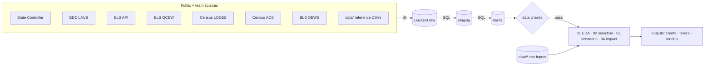

# Methods

[← Decisions](01_decisions.md) · [README](../README.md) · Next: [Conclusions →](03_conclusions.md)

> **Key:** **R1** Ontario Career Pathways & Employer Consortium (education → paid internships → local careers) ·
> **R2** A Connected Destination Economy (joint City–ONT visitor outreach and hotel packages, plus a two-bus
> evening transit pilot) · **R3** Clean, Safe & Green Entertainment Districts (a DOIA-led Downtown ambassador
> pilot, with green improvements phased in). Full descriptions: [Background](00_background.md#the-recommendations-being-tested).
> Methods also covers R4 (international and employer attraction), which the model keeps as a possible later
> phase; it is not in the current proposal.

Part A is the **data engineering** that produces clean, fiscal-year-aligned tables. Part B is the
**data science**: the status-quo baseline, then the impact method for each recommendation.

---

## Part A: Data engineering

Code paths below are relative to the `ontario_forecast_model/` folder (for example
`src/fiscal_impact_model/ingest/` is `ontario_forecast_model/src/fiscal_impact_model/ingest/`). Input data
(`data/`) and results (`outputs/`) sit at the top of the repository.

### A1. Pipeline

Orchestration: Nx runs `ingest → transform → eda/select → scenarios/impact → report`.
`e2e` = lint + tests, then a fresh pull, then `report`.

### A2. Ingestion (`src/fiscal_impact_model/ingest/`)

| Resource | Source / method | Notes |
|---|---|---|
| `sco_city_revenue_lines` | Socrata API through dlt `RESTClient` + `OffsetPaginator` | Ontario + 10 peers, all revenue lines, FY2003+ |
| `laus_city_monthly` | data.ca.gov CKAN → streamed CSV | Filtered to the 11 cities while streaming |
| `bls_observations` | BLS API v2 (POST, chunked by series and year window) | Total nonfarm, leisure & hospitality, and transport & warehousing jobs; MSA unemployment; CPI-LA; CPI lodging. Preliminary values flagged |
| `qcew_county_annual` | BLS QCEW open-data CSV | San Bernardino County, total + NAICS sectors, private ownership |
| `oews_msa_occupations` | BLS API (OE series) | 14 occupations mapped to the proposal's career pathways |
| `lodes_ontario_flows` | Census LODES 8 OD (main + aux), **aggregated inside DuckDB over HTTPS** | One row per year; incremental, so loaded years are skipped |
| `acs_place` | Census API (key) | B08008, B08303, B15003, B19013 for Ontario + the county |
| `manual_<file>` | The reference files in `data/` (see [A6](#a6-input-data-data)) | Hand-entered official figures, each with a source column. The impact-model inputs, also in `data/`, are read directly by the model and never ingested |

All API keys come from environment variables or `ontario_forecast_model/.dlt/secrets.toml`, which is never committed.

### A3. Transformation (`transform/sql/`)

- **Parameter tables:** COVID years, ACS vintages, BLS series IDs and proposal fallbacks are written from
  `config.py` into `staging.*` tables, so the SQL never hard-codes them.
- **Staging:** one cleaned, typed table per source.
  - `city_tax_fy`: the hotel-tax rename is joined, the triple flip is added back, and only General Revenues lines are kept.
    Measure Q (the City's 1% transactions and use tax, approved November 2022) is kept as its own column,
    outside the forecast series, so it doesn't create a false jump.
  - `laus_city_month`, `bls_month`: monthly series.
  - `lodes_ontario_cy`: live/work counts and shares.
  - `acs_place`, `oews_msa`, `city_budget`.
- **Marts:**
  - `ontario_fy_panel` is the modeling table. It holds fiscal-year averages that require all 12 months, real
    dollars, log-growth columns, and a COVID flag.
  - `city_tax_fy` covers the peer cities.
  - `msa_occupation_wages`, `acs_place_of_work` (with Census margin-of-error formulas) and `acs_vintage_change`
    (non-overlapping vintages only, with 90% significance) hold the survey data.
  - `headline_metrics` takes the official value first and the proposal figure only as a flagged fallback.

### A4. Data quality (`transform/checks.py`)

Each check is a query that returns the rows breaking a rule. **Errors stop the export**; warnings are printed.
The marts listed above are exported as CSV to `outputs/tables/` once the checks pass.

| Errors | Warnings |
|---|---|
| Unique city × fiscal year; non-negative revenue; TOT and sales tax present every year; consecutive fiscal years; no fiscal year with more than 12 months; LODES shares in [0, 1]; ACS shares in [0, 1]; positive wages | Missing deflator; real TOT growth over ±60%; LODES year missing its out-of-state file; proposal fallbacks still in use; official vs proposal difference over 5%; suppressed OEWS medians |

### A5. Testing and reproducibility

- **pytest suite** (`src/fiscal_impact_model/tests/`), covering:
  - statsmodels/scipy wrappers
  - SQL run on hand-made tables
  - LODES aggregation
  - dlt resource construction
  - backtest and lookahead checks
  - scenario math
  - every impact mechanism and the ROI math, run on the real input files
- **Reproducibility:** `uv.lock` and `pnpm-lock.yaml` lock dependencies, and fixed random seeds make every simulation repeatable.

### A6. Input data (`data/`)

Every input CSV lives in `data/` and is tracked in git. There are two kinds, listed in `config.py`, and a test
fails if a CSV in `data/` belongs to neither list.

**Reference data** (`config.REFERENCE_FILES`): official figures that have no download API. Each is loaded by
dlt as `raw.manual_<file name>`, with every column as text (the SQL casts them). Each row has a `source`
column citing the document and page. Header-only templates load nothing until rows are added. Never type an
estimate as if it were an observation: leave a cell blank when it isn't known.

| File | Columns | Source |
|---|---|---|
| `city_budget_revenue.csv` | fy, tot_budget, sales_tax_budget, source | City of Ontario adopted budget (document and page). Replaces the proposal's quoted FY27 figures everywhere. `sales_tax_budget` is the budget's "Sales Tax" total, which includes Prop 172 and Measure Q |
| `city_sales_tax_detail.csv` | fy, basis (actual / adopted / current), sales_use_tax, prop_172, measure_q, total_sales_tax, tot, source | Same budget book, revenue detail page. Splits "Sales Tax" into Bradley-Burns (the series the forecast uses), Prop 172 and Measure Q |
| `ont_airport_passengers.csv` | fy, passengers, source | Ontario International Airport monthly traffic reports (empty template) |

**Impact-model inputs** (`config.IMPACT_INPUT_FILES`): read directly by the model and never loaded into the
warehouse, because they are inputs, not observed data.

| File | What it holds |
|---|---|
| `impact_assumptions.csv` | Every model input as a low / likely / high range, with unit, **status** and **source** |
| `impact_phases.csv` | Start year and full-scale year of each recommendation (from the proposal's phases) |
| `anchor_visitors.csv` | Annual visitors, overnight share and `arrival_share` for each City venue the visitor program builds on. `arrival_share` converts a venue's count into inbound trips (0.5 for the airport, which counts each traveler on arrival and departure) |
| `city_investments.csv` | How each City investment maps to the parts of the model that measure it |

Each impact-model input carries a status:

| Status | Meaning | Can it enter a reported result? |
|---|---|---|
| `official` | From a government source: State Controller, Census, BLS, the City budget or Municipal Code | Yes |
| `published` | From a peer-reviewed study or a recognised industry benchmark (for example the NACE internship survey) | Yes |
| `proposal` | Stated in the proposal itself, such as program costs and phase timing | Yes |
| `assumption` | A team estimate with no external source yet | **No** |

Rules for both kinds:
- **Every row needs a source.** For an `assumption`, the source text says where a real value should come from.
- **Ranges come from the source, not from judgment.** Where a source gives a range (such as a cost range in the
  proposal), use it; don't widen or narrow it by hand.
- **No simulated result is reported for a recommendation while any of its inputs is an `assumption`** (see B4).
  `outputs/tables/impact_evidence_gaps.csv` lists what's missing, and `outputs/tables/impact_inputs_used.csv`
  lists every input the last run used, with its status and source.
- **Tests check the files on every run:** valid ranges, known statuses, a source on every row, and every file
  listed in [Sources](04_sources.md).

Also wanted: hotel occupancy and average room rate (STR or CoStar), if the City or the visitors bureau can share
them.

---

## Part B: Data science

### B1. Exploratory analysis (`analysis/01_eda.py`)

1. **Sample size per variable:** about 20 annual points, which caps model complexity.
2. **Definitional breaks:** before/after the triple-flip correction.
3. **Nominal vs real dollars.**
4. **Levels vs growth:** shows how a shared trend creates a false correlation.
5. **Stationarity tests:** ADF and KPSS from statsmodels, used as supporting evidence because they're weak at n≈20.
6. **COVID weight:** how much of the total variation the pandemic years account for.
7. **Peer cities:** real hotel tax per capita, indexed.
8. **Live/work share:** the trend, and which LODES year matches the proposal's 14.8% (2019).
9. **County pay by sector.**
10. **OEWS wages vs the proposal, and the ACS cross-check.**

### B2. Baseline forecast (`analysis/02_variable_selection.py`)

**Target:** real log-growth $g_t = \ln(R_t) - \ln(R_{t-1})$ for hotel tax and for sales tax.

**Six candidates named in advance, lag 1:**
- leisure & hospitality jobs (MSA)
- nonfarm jobs (MSA)
- transport & warehousing jobs (MSA)
- city employment (LAUS)
- hotel prices (CPI lodging)
- change in the MSA unemployment rate

**Steps:**
1. **Screening (descriptive only):** Pearson and Spearman correlations with confidence intervals, and
   Holm-adjusted p-values. Done both with and without COVID years.
2. **Overlap between candidates:** variance inflation factors (VIF).
3. **Expanding-window backtest:** at each year *t*, the model is fit only on years before *t*, with COVID-affected
   rows excluded from fitting. It predicts year *t*, and errors are converted to dollars using the known prior-year level.
4. **Fair comparison:** each model is compared with "same as last year" **on its own available years**, giving
   `rel = MAE / naive MAE`. A model needs at least 5 test years outside COVID to be eligible.
5. **Selection:** a model must cut naive's error by **at least 10%** (`config.SELECTION_MIN_GAIN`), both with and
   without COVID. Among those, pick the simplest within 5% of the best. Otherwise naive is used. The margin
   exists because about 9 models are compared on about 8 test years: a 2–7% edge there is what luck looks like.
6. **Saved model:** fitted with statsmodels OLS and stored as JSON (coefficients plus out-of-sample errors),
   so the deployed model is numpy only.

### B3. Status-quo scenarios (`analysis/03_scenarios.py`)

$$g^{(s)}_{T+h} = \mu_h + e^{(s)}, \qquad e^{(s)} \sim \text{resample(out-of-sample errors} - \bar e)$$

$$R^{(s)}_{T+h} = R_T \cdot \exp\Big(\sum_{k \le h} g^{(s)}_{T+k}\Big)$$

- **Simulation:** 20,000 simulated futures with a fixed seed. P10/P50/P90 are taken per year.
- **Persistent errors:** if a model's errors are clearly correlated from one year to the next (lag-1
  correlation of 0.4 or more, capped at 0.9), the draws are chained:
  $e_t = \rho\, e_{t-1} + \sqrt{1-\rho^2}\; e^*_t$. Each year keeps the same spread, but a run of good or bad
  years can build up, so the range widens with the horizon. This applies to hotel tax; sales-tax errors show no
  such pattern and are drawn independently.
- **Centered errors:** the average error is removed before resampling, so the middle of the range is the
  selected model's own forecast. Without this, a "same as last year" model would grow each year by its
  average past error, which is the trend model it was chosen over.
- **Model types:** AR(1) runs recursively. A lag-1 driver uses its last observed value in year 1 and its
  historical average afterwards.
- **Live/work share:** simulated on the logit scale, so shares stay between 0 and 1.

### B4. Recommendation impact model (`src/fiscal_impact_model/modeling/impact.py`)

**General method:**
- **Inputs:** every input has a triangular (low, likely, high) range from `impact_assumptions.csv` and a status
  (official, proposal or assumption).
- **Simulation:** 20,000 joint draws, combined with the baseline sales-tax simulation.
- **Phase ramps:** each recommendation is 0 before its start year and rises linearly to 1 at full scale
  (`impact_phases.csv`, from proposal §5).
- **Outputs:** real FY2025 dollars, per recommendation and channel (hotel, sales, property tax), net of City cost.

Notation: $r_t$ = phase ramp, $S(x)_t = S_{t-1}(1-a) + x_t$ = a cumulative total with yearly attrition $a$.

**City sales-tax rate $\tau$.** Spending made in person in Ontario (visitors, Downtown, residents) earns the
City **2%**: the 1% Bradley-Burns share plus the 1% Measure Q transactions and use tax. Business-to-business
sales of attracted firms earn **1%** (Bradley-Burns only), because Measure Q follows the delivery address,
which is usually outside the city. **This allocation needs confirming with City Finance or its sales-tax
consultant:** local sales and use tax can depend on where a sale is sourced, delivery, use-tax rules and how a
transaction is structured.

**What gets reported.** A recommendation's simulated result (return per dollar, net impact, residents added) is
reported only when every input behind it has a source (`official`, `published` or `proposal`).
`impact.evidence_gaps` lists what's missing; while anything is, `04_impact.py` stops after writing the break-even
targets and the gap list. The formulas below are kept so the estimates can be produced once the inputs exist.

**Break-even targets** (`impact.break_even_targets`) use only official tax rates, actual tax revenue and the
proposal's stated cost ranges (low and high, never a midpoint):
- **R2:** added hotel tax needed = program cost, so added room revenue = cost ÷ 11.75%.
- **R3:** net new in-person taxable sales needed = program cost ÷ 2% (1% Bradley-Burns + 1% Measure Q).
- Both scale linearly with the City's share: per $100K of City money, R2 needs $100K of hotel tax and R3 needs $5M
  of net new sales.

#### R1 Career Pathways

$$\text{hires}_t = I \cdot r_t \cdot c \cdot \alpha_1 \cdot \rho_1$$

*I* = interns per year at full scale, *c* = share converted to jobs, $\alpha_1$ = share of hires that wouldn't
have happened anyway, $\rho_1$ = share of hires who live in Ontario.

- **Residents working in Ontario:** $W^{R1}_t = S(\text{hires})_t$
- **Sales tax:** $W_t \cdot \text{wage} \cdot \text{taxable share} \cdot \text{local capture} \cdot \tau \cdot \nu$, where
  wage = the OEWS range across pathway occupations (official).
- **Counterfactual $\nu$:** a placed worker who would have lived in Ontario anyway was already spending here.
  Only new or retained residents count in full; for the rest, only the *gain* in local spending counts:
  $\nu = s + (1 - s)\cdot g$, with *s* = share who are new or retained residents and *g* = spending gain.
- **Residency:** households = $W_t \cdot$ share who are new or retained residents. These add property tax, plus
  taxable spending by the other household members.
- **Success metric:** added residents working locally, compared with the LODES status-quo share.

#### R2 A Connected Destination Economy (hotel packages)

For each anchor *k* (ONT, Mills, Toyota Arena, Sports Empire):

$$\text{nights}_{k,t} = V_k (1+\gamma)^t \cdot o_k \cdot d \,/\, p \cdot u \cdot \alpha_2 \cdot r_t$$

$V_k$ = inbound visitor trips (for ONT, half the passenger count: airports count each traveler on arrival
*and* departure), $\gamma$ = growth in visits, $o_k$ = overnight share, *d* = share of unique trips,
*p* = people per room, *u* = share of overnight parties taking a hotel package (the Stay +1 package), $\alpha_2$ = share of extra nights that wouldn't have happened anyway.

- **Hotel tax:** nights × average room rate × TOT rate.
- **Room rate:** an implied rate, derived rather than guessed (not an observed rate). Hotel tax ÷ 11.75% gives citywide room revenue; dividing by the City's
  5,670 rooms × 365 nights gives revenue per available room-night; dividing by occupancy (60–75%, a team
  assumption) gives the average rate. This guarantees the rate is consistent with the hotel tax actually collected.
- **Sales tax:** nights × *p* × daily visitor spending × $\tau$.
- **Leverage by investment:** revenue per anchor (`impact_stay1_by_anchor.csv`), once the inputs are sourced.
- **Sanity check:** the overnight parties this chain implies are compared with the room-nights implied by
  actual hotel tax (`04_impact.py` prints both). The anchors can't fill more rooms than the city sold.
- **Success metric:** hotel tax with vs without the packages, and average visitor stay. The evening transit pilot's
  cost is counted; its effect on spending isn't modeled.

#### R3 Clean, Safe & Green Entertainment Districts

$$\Delta\text{ST}_t = \text{baseline sales tax}_t \cdot \text{downtown share} \cdot \text{uplift} \cdot \alpha_3 \cdot r_t$$

$\alpha_3$ = share of the uplift not shifted from elsewhere in Ontario. The baseline comes from the B3 simulation
(Bradley-Burns revenue), scaled to the 2% in-person rate.

- **Success metric:** district taxable sales, foot traffic and perceived safety. The last two are dashboard KPIs, not modeled in dollars.

#### R4 International & employers, and the R1→R4 synergy (not in the current proposal)

- **Jobs:** $\text{jobs}_t = S(F \cdot J \cdot \alpha_4 \cdot r_t)$, with *F* = firms per year and *J* = jobs per firm.
  Resident workers = jobs × resident share.
- **Revenue:** sales tax from resident wages, plus business taxable sales per job × $\tau$, plus residency effects.
- **Synergy:** extra firms per year = $\sigma \cdot W^{R1}_{t-1}/100$ once R4 is active. This is the proposal's
  "structured workforce pipeline" claim, reported as a **separate line** so it can be judged alone.

### B5. Investment leverage and sensitivity

- **Leverage** (`investment_leverage`): `city_investments.csv` maps each City investment to the parts of the model
  that measure it (an anchor, a recommendation, or a revenue channel). Uncountable ones, such as the
  Convention Center and the West Valley Connector, are listed as not modeled rather than given a number.
- **Sensitivity** (one input at a time): every input at its likely value, then each swung to its low and high.
  Inputs are ranked by their effect on the long-term cumulative net. This ranking sets the sourcing priority.

### B6. Cost and return on investment

For each recommendation (R4 grouped with the R1→R4 synergy, which has no cost of its own), per simulation:

- **Headline window = the whole program (FY27–36).** It includes the start-up years, when the City pays in full
  while revenue is still ramping. The FY30–36 window on its own leaves those out and overstates the return, so
  it's shown only to describe how returns mature.
- **Return per $1:** benefit-cost ratio = gross tax revenue ÷ City cost, both in **present value** at the launch
  year, using a real discount rate of 2–5% (likely 3%).
- **R1 + R4 together:** the R1→R4 link earns revenue only because R1 is funded. Crediting that revenue to R4
  while R1 carries the cost makes R4 look better and R1 worse than they are, so the pair is also reported as one
  group with both costs.
- **Break-even annual City cost:** gross ÷ years the program has cost. This is the most the City could
  contribute each year and still be repaid by the program's own tax revenue.
- **Simulations that break even:** share of simulations where gross revenue ≥ cost. The simulations are
  built from triangular input ranges that are mostly team estimates, so this describes the model, not an
  estimated real-world probability.
- **Year 1 City cost:** checked against the proposal's $500K cap.

Output: `impact_roi.csv` and the `impact_roi` chart, produced only once the inputs above are sourced. Until then
the outputs are `impact_break_even_targets.csv`, `impact_evidence_gaps.csv` and the `impact_break_even` chart.

### B7. Known limitations

- 34 of 43 impact inputs are team assumptions, and the dollar figures depend on them.
- About 9 out-of-sample errors make the ranges coarse, and the year-to-year correlation carried into the
  hotel-tax simulation is itself estimated from those few points.
- Picking the best of about 9 models on the same years makes the winner's error slightly optimistic.
- Not modeled: multiplier effects, spending by non-resident workers, the program's effect on venue attendance
  itself, and dollar values for safety and quality of life. These omissions make the model conservative.
- **Not conservative: housing supply.** New resident households add property tax and population only if the
  home would otherwise be empty or unbuilt. The model doesn't test that, so treat the residency figures as an
  upper bound.
- A "same as last year" baseline means flat real revenue for ten years. It's the honest result of the
  backtest, not a prediction that Ontario stops growing; faster growth raises R3 in proportion.

Next: [Conclusions →](03_conclusions.md)
