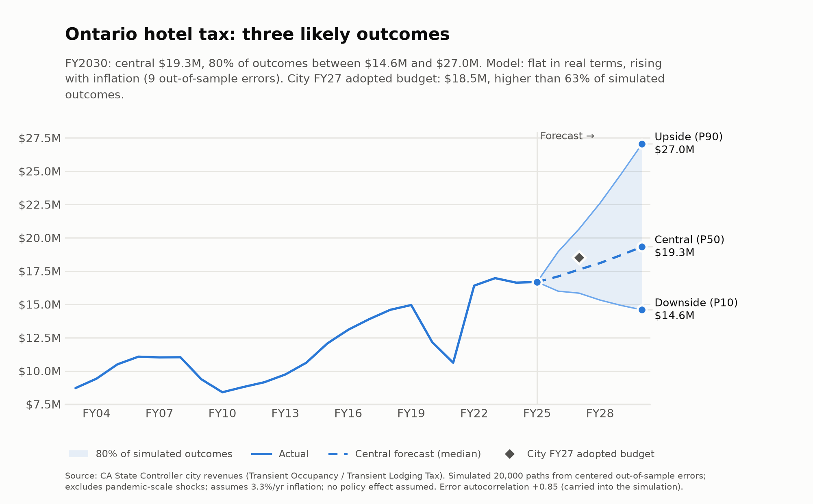
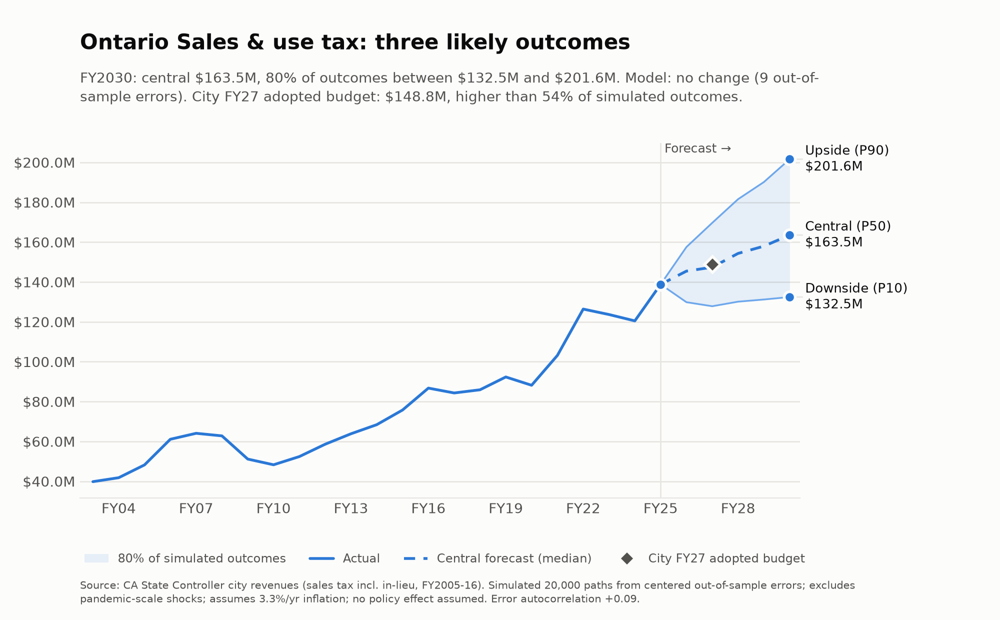
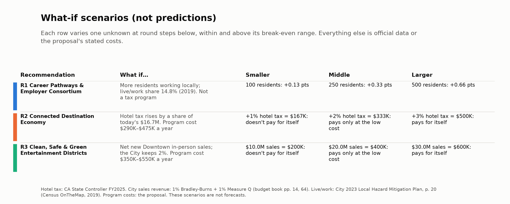

# Conclusions

[← Methods](02_methods.md) · [README](../README.md)

> **Key:** **R1** Ontario Career Pathways & Employer Consortium (education → paid internships → local careers) ·
> **R2** A Connected Destination Economy (joint City–ONT visitor outreach and hotel packages, plus a two-bus
> evening transit pilot) · **R3** Clean, Safe & Green Entertainment Districts (a DOIA-led Downtown ambassador
> pilot, with green improvements phased in). Full descriptions: [Background](00_background.md#the-recommendations-being-tested).

> **In one sentence:** the model forecasts Ontario's hotel and sales tax if nothing changes, sets a break-even test
> for each recommendation, and shows what-if scenarios for the one unknown that decides each; it does not forecast
> what the recommendations will earn.

> **What this page reports.** Only results built from sourced inputs: the status-quo forecasts (fitted to State
> Controller data and tested on years the model hadn't seen) and the break-even targets (official tax rates,
> actual tax revenue and the proposal's stated costs). It does **not** report a projected return for any
> recommendation, because each one still depends on inputs that are team estimates rather than data; §4 lists
> them. Regenerate every figure with `pnpm nx run ontario-forecast:report` (from `ontario_model/`).

## 1. If nothing changes (status-quo baseline)

| Target | Selected model | Out-of-sample result |
|---|---|---|
| Hotel tax (TOT) | **"Same as last year"** (naive) | The best candidate (transportation & warehousing jobs) beat naive by only 2% over all test years and 7% outside COVID, on 8 test years. That's under the 10% margin a model needs to be trusted |
| Sales tax | **"Same as last year"** (naive) | No candidate beat naive both with and without COVID |

**What this means:** with about 20 yearly data points, no indicator reliably predicts either tax better than
last year's value. The baseline is flat in real terms (growing with inflation), with a range from past errors.

- **Hotel tax, FY2030:** central **$19.3M** (80% of outcomes between $14.6M and $27.0M, nominal).
- **FY27 budget figure ($18.5M):** **higher than 63% of simulated outcomes** (central estimate $17.6M). It's
  on the optimistic side under the status quo. The $18.5M is confirmed in the City's adopted budget, which
  plans for 8.8% growth over the FY26 year-end estimate of $17.0M.
- **Why the range is wide:** hotel-tax forecast errors are strongly correlated year to year (**+0.85**), so a
  good or bad year tends to be followed by another. The simulation carries that forward. The correlation is
  estimated from only 9 years, so treat the width as approximate.

- **Sales tax, FY2030:** central **$164M** ($132M to $202M, nominal). This is the Bradley-Burns 1% only; it
  doesn't include Measure Q.
- **FY27 budget, like for like:** the City budgets **$148.8M** for the Bradley-Burns part. The model's central
  FY27 estimate is $147.4M, so the two agree closely (the budget is higher than 54% of simulated outcomes).

## 2. What each recommendation must achieve to pay for itself

These targets need no estimate of how well a program will work. They say what it would have to produce, in City
tax revenue, to cover its own cost. The proposal states each program's full cost but not how it splits between the
City and partners, so the targets use the full cost, and the last column scales them to any City share.

| | Program cost per year (proposal, City + partners) | Pays for itself in City tax when it adds… | Per $100K of City money | Share of today's citywide base |
|---|---|---|---|---|
| **R1** Career Pathways | $75K–$150K (staffing and coordination) | Not a tax-revenue program: judge it on placements, wages and retention | — | — |
| **R2** Connected Destination Economy | $290K–$475K (outreach and packages $100K–$250K + evening transit pilot $190K–$225K) | **$290K–$475K more hotel tax a year**, which means $2.5M–$4.0M more hotel room revenue | $100K of hotel tax | 1.7%–2.8% of FY2025 hotel tax ($16.7M) |
| **R3** Clean, Safe & Green Entertainment Districts | $350K–$550K (ambassador pilot) | **$17.5M–$27.5M of net new Downtown taxable sales a year**, after any sales shifted from elsewhere in Ontario | $5M of new sales | Needs Downtown's sales base, which the City's sales-tax consultant holds |

How these are built:
- **Hotel tax** is 11.75% of room revenue (Municipal Code §3-6.03), so every $1 of hotel tax needs $8.51 of room
  revenue.
- **Sales tax:** the City receives 1% of taxable sales through Bradley-Burns and 1% through Measure Q (budget book
  pp. 14, 64), so every $1 of City revenue needs $50 of new taxable sales made in Ontario. How local sales tax is
  allocated should be confirmed with City Finance (see §6).
- **R2 counts hotel tax only.** Visitors' other spending also earns sales tax, but estimating it needs a
  spend-per-visitor figure that isn't sourced yet. The R2 target is therefore conservative.
- **Annual, steady-state and undiscounted.** These are yearly targets for a program running at full scale.

### What-if scenarios (not predictions)

| Recommendation | What if… | Smaller | Middle | Larger | Program cost per year |
|---|---|---|---|---|---|
| **R2** Connected Destination Economy | hotel tax rises by… | 1%: +$167K, doesn't pay for itself | 2%: +$333K, pays only at the low cost | 3%: +$500K, pays for itself | $290K–$475K |
| **R3** Clean, Safe & Green Entertainment Districts | net new Downtown sales are… | $10M: +$200K, doesn't pay for itself | $20M: +$400K, pays only at the low cost | $30M: +$600K, pays for itself | $350K–$550K |
| **R1** Career Pathways & Employer Consortium | more residents work in Ontario… | 100: +0.13 pts | 250: +0.33 pts | 500: +0.66 pts | $75K–$150K (not a tax program) |

**How to read it:**
- **Scenarios, not predictions.** Each row varies one unknown: how much hotel tax rises, how much new Downtown
  sales the pilot brings, how many more residents work locally. Its smaller, middle and larger values are
  round steps chosen to sit below, within and above the break-even range. Nothing says which one will happen.
- **Everything else is sourced.** Hotel tax is FY2025's $16.7M (State Controller); the City keeps 2% of in-person
  sales (1% Bradley-Burns + 1% Measure Q); program costs are the proposal's; the live/work baseline is 14.8% of
  75,283 employed residents in 2019 (City 2023 Local Hazard Mitigation Plan, citing Census OnTheMap).
- **Why "smaller, middle, larger" and not "low, medium, high":** in the status-quo forecast, low/likely/high are
  statistical, the range covering 80% of simulated outcomes. Here the levels are chosen, not estimated, so they
  get different names.
- **Why not a full simulation:** a projected return would chain several unknowns together (overnight share,
  package uptake, Downtown's share of sales, how much is truly additional). With none of them sourced, the result
  would be driven by guesses. One stated unknown per row keeps every assumption visible.
- **When this becomes a forecast:** the pilots' Phase 1 measures (redemptions, nights added, Downtown sales,
  placements) are the missing inputs. Once they're in, the model's impact simulation reports a projected return.

Table: `outputs/tables/impact_what_if_scenarios.csv`. Scenario levels: `config.WHAT_IF_LEVELS`.

## 3. Combined cost against the $500K Year 1 cap

The proposal caps City spending in Year 1 at $500K and has partners cover the rest. Its program descriptions add
up as follows:

| | Low | High |
|---|---|---|
| Combined program cost, all three recommendations (from the program descriptions) | $715K | $1,175K |
| The proposal's budget table (staffing + implementation + marketing) | $450K | $900K |
| **Year 1 City cap** | **$500K** | **$500K** |

- **Partners carry the difference.** At the combined program cost, partners would cover at least $215K (low end)
  to $675K (high end) a year for City spending to stay within the cap, consistent with the proposal's cost-sharing
  plan with DOIA, property owners, employers, hotels, venues and transit partners.
- **The two cost views differ.** The ambassador pilot ($350K–$550K) and the evening transit pilot ($190K–$225K)
  together come to $540K–$775K, above the budget table's "program implementation" line ($275K–$500K). The model
  uses the program descriptions' figures, the higher of the two, so its targets are conservative.
- **Each recommendation is assessed on its own,** with its own budget and success measures, so success in one
  cannot mask weakness in another (as the proposal sets out).
- **The proposal's launch order:**
  1. **First, using existing staff and budgets:** Career Pathways (employer and school convening, the first paid
     internship cohort) and the visitor outreach, alongside the baseline safety survey.
  2. **The Downtown ambassador pilot,** once the baseline safety survey is complete and DOIA and property owners
     have committed their share.
  3. **The evening transit pilot,** after the City's Internal Circulator Planning Study is completed in December
     2026 (budget book pp. 408, 487), so the study can set its route, cost and funding.

## 4. What the model can't estimate yet, and what would let it

A projected return needs every link in the chain to be sourced, for example visitors → share staying overnight →
share taking a hotel package → extra nights. Those links are currently team estimates, so no return is reported.
`outputs/tables/impact_evidence_gaps.csv` lists every one, with where to source it. The ones that matter most:

| | Unsourced inputs | Who holds the data |
|---|---|---|
| **R3** | Downtown's share of citywide taxable sales; the sales uplift from the program; how much of it is shifted from elsewhere in Ontario | The City's sales-tax consultant; a measured pilot with a comparison district |
| **R2** | Share of visitors staying overnight at each venue; share taking a hotel package; nights that wouldn't have happened anyway; hotel occupancy; visitor spending per day | Venue and ONT visitor surveys; hotels and the visitors bureau; STR or CoStar; Visit California's county travel report |
| **R1** | Share of hires who live in Ontario; hires that wouldn't have happened anyway; how long placed workers stay; resident spending patterns | Program tracking (participant address and employment at 1, 3 and 5 years); BLS Consumer Expenditure Survey |

What is already sourced: tax rates and revenue (State Controller, City budget), hotel room supply (budget book),
airport passengers (airport authority, FAA), pathway wages (BLS), household size (Census) and internship conversion
rates (NACE national survey).

**On the R3 evidence specifically:** the strongest study we found, of Los Angeles business improvement districts
(Brooks, 2008), shows reductions in serious crime. We found no rigorous evaluation showing that ambassador
programs raise sales. R3's fiscal case therefore can't yet be stated as an expected return, only as the
break-even target above.

## 5. How each recommendation's success is measured

The measures below are the proposal's own (its Table 1.1 and Table 1.2), with the baseline the model can already
supply where one exists, and each recommendation's break-even test.

| | Proposal's measures | Baseline already available | Fiscal test |
|---|---|---|---|
| **R1** | Ontario jobs held by Ontario residents; internship-to-employment rate; six-month employment retention; business retention and expansion; starting wages | Residents held **8.8%** of Ontario's jobs in 2019, and 14.8% of employed residents worked in the city (2023 Local Hazard Mitigation Plan, p. 20, citing Census OnTheMap) | None: a workforce and equity investment. Moving the live/work share one point takes about 750 more residents working locally (1% of 75,283 employed residents in 2019) |
| **R2** | Evening transit ridership (boardings per service hour, cost per boarding); QR-guide engagement and offer redemptions; visitor-reported visits to multiple destinations; changes in visitor stay | FY2026 Omnitrans fixed-route cost: $153.70 per revenue hour (Service Plan FY2026, Exhibit 10) | Hotel tax up $100K for every $100K of City money |
| **R3** | Downtown visitor activity (pedestrian traffic, QR-guide engagement, ambassador interactions); ambassador coverage hours and service requests resolved; the baseline safety survey | Police report 105 acceptances of assistance from 380 encampment clean-ups, about 28% (budget book p. 319) | Net new Downtown sales of $5M for every $100K of City money |

### Further safety measures the pilot could add

For an entertainment district, how safe people *feel* decides whether they stay later and spend, so the pilot
should track both actual conditions and perception:

| Measure | What to track | Team-proposed target | Why this one |
|---|---|---|---|
| **Perceived safety** | Survey visitors, residents and Downtown businesses before launch, then each year | +10 percentage points saying they feel safe in the pilot area | The mechanism behind any sales gain; the business wave also shows whether safety and homelessness drop down the list of top concerns |
| **Repeat problem locations** | Calls for service at addresses with repeat disorder or public-safety calls | Fewer repeat locations, not just fewer calls | Total calls can rise when more people are out, or when ambassadors report more |
| **Evening foot traffic, alongside incidents** | Evening visitor counts in the district against incident counts | Foot traffic up while incidents stay flat or fall | The clearest sign the district is getting busier and more comfortable; with district taxable sales, it tests the R3 break-even target directly |
| **Clean-up response time** | Time to fix graffiti, litter and maintenance reports | Within 24 hours | Visible disorder drives perception, and this is the part the City controls directly |
| **Service acceptance** | Referrals by outreach or ambassador teams, and how many unhoused people accept shelter, treatment or navigation | Above today's baseline: Ontario Police report 105 acceptances from 380 encampment clean-ups, about 28% (budget book p. 319) | Measures outcomes for people, not just contacts, and answers the businesses' top concern |

Ambassador activity counts and outreach response time are worth reporting as contract performance, but they
measure effort rather than results. Two design points make the measures credible:
- **Take the baseline before launch** (the proposal's 0–3 month phase).
- **Compare with a similar district that doesn't get the program**, so citywide trends aren't credited to R3.
  Detecting a 10-point change in perceived safety needs roughly 400 survey responses per wave (at a 50% baseline,
  80% power).

## 6. Data reconciliation

- **Sales tax: reconciled.** The proposal's ~$216.3M is the City budget's "Sales Tax" total for FY27, which has
  three parts: Sales & Use (Bradley-Burns) **$148.8M**, Measure Q **$64.3M** and Prop 172 **$3.2M**. The State
  Controller's ~$139M for FY2025 is the Bradley-Burns part alone, and it matches the budget book's FY2025
  actual to the dollar. Both numbers are right; they measure different things.
- **Measure Q** brought in **$60.8M** in FY2024 and **$61.6M** in FY2025, below the roughly $95M estimated before the 2022 vote. The
  State Controller files it under "Other Taxes – Other".
- **Hotel tax rate: confirmed at 11.75%** (Municipal Code §3-6.03). The model had assumed 11–12%.
- **Hotel revenue per room:** actual hotel tax ($16.7M) ÷ 11.75% ÷ 5,670 rooms ÷ 365 nights = about **$69 per
  available room-night**. Splitting that into an average room rate and occupancy needs occupancy data, which isn't
  public (STR, CoStar or the visitors bureau hold it).
- **Local sales-tax treatment: needs City confirmation.** The model credits the City 2% on in-person spending
  (1% Bradley-Burns plus 1% Measure Q) and 1% on business-to-business sales. How local sales and use tax is
  allocated can depend on where a sale is sourced, delivery, use-tax rules and how a transaction is structured.
  The logic is reasonable, but confirm it with City Finance or its sales-tax consultant before relying on
  precise fiscal figures.
- **Live/work 14.8% (2019): confirmed.** The City's 2023 Local Hazard Mitigation Plan (p. 20, citing Census
  OnTheMap), which the proposal cites, gives 75,283 employed residents, 11,107 (14.8%) of them working in Ontario,
  holding 8.8% of the city's ~126,883 jobs. The model uses these 2019 figures; the proposal's summary also quotes
  about 15.5%. LODES will update the figures to the latest year once loaded.
  The figure shows how few working residents also work in Ontario; on its own it doesn't explain why (see
  [Background](00_background.md#the-problem)).

## 7. What to watch during implementation

### Recommendation 1: Ontario Career Pathways & Employer Consortium
- **Judge it on its workforce results.** Its value is placements, wages, retention and employer relationships, as
  the proposal's measures reflect; it isn't designed to raise tax revenue directly.
- **Scale and the citywide share.** Each one-point rise in the live/work share needs about 750 more residents
  working locally, so the cohort-level measures (placements, conversions, retention) are the ones that will move first.

### Recommendation 2: A Connected Destination Economy
- **Outreach first, transit after the study.** Following the proposal's order, the outreach and packages start
  with existing budgets, and the transit pilot follows the City's circulator study.
- **Partner contributions lower the target.** Hotels keep the room revenue from every added night; the City keeps
  11.75% of it. For every $100K hotels and venues contribute, the City's hotel-tax target falls by $100K.
- **Phase 1 as measurement.** Recording redemptions, nights added and whether the guest would have stayed anyway
  turns R2's unsourced inputs into data.

### Recommendation 3: Clean, Safe & Green Entertainment Districts
- **The City's share.** The proposal funds it from the existing Homeless Services allocation (about $4.5 million
  in the FY2026–27 General Fund; $4,450,688 in the budget book, p. 141), alongside DOIA and property owners.
  DOIA's Community Benefit District is funded by Downtown property and business owners and lists security and
  case-worker services among its planned improvements. The break-even test applies to whatever share the City pays:
  $5M of net new Downtown sales per $100K.
- **Downtown's taxable sales** from the City's sales-tax consultant would show how large that target is relative to
  Downtown's base.

## 8. Data to collect in Phase 1 (0–3 months)

The proposal's first phase establishes program budgets, baseline data and funding commitments. These are the data
that would let the model move from break-even targets to estimated returns:

| # | What to get | Who has it | What it settles |
|---|---|---|---|
| 1 | Downtown pilot district's taxable sales | City Finance / the City's sales-tax consultant | How large R3's break-even target is relative to Downtown's base |
| 2 | Partner cost commitments for each program | DOIA, property owners, employers, hotels, venues, transit partners | The City's share, and so each program's City-funded target |
| 3 | How local sales tax is allocated (the 1% + 1% treatment) | City Finance / the City's sales-tax consultant | Whether the R3 target can be relied on precisely |
| 4 | Circulator route, cost and funding | The City's Internal Circulator Planning Study (December 2026); Omnitrans; SBCTA | R2's transit cost and timing |
| 5 | Hotel occupancy and average room rate | The visitors bureau (GOCAL), STR or CoStar | Converts R2's target into a number of nights |
| 6 | Baseline safety survey and Downtown foot traffic | The pilot's baseline survey; counters or ambassador logs | R3's starting point |
| 7 | LODES load to update the live/work figures beyond 2019 | This pipeline (`ingest-lodes`) | R1's baseline |
| 8 | Employer and college commitments to the first cohort | Consortium members | R1's first-year scale |

**Repository items** are tracked in [Sources](04_sources.md#open-items).

## 9. Summary

1. **If nothing changes,** hotel and sales tax stay roughly flat in real terms. The City's FY27 hotel-tax budget
   ($18.5M) is above 63% of the status-quo outcomes; its Bradley-Burns sales-tax budget ($148.8M) matches the
   forecast closely ($147.4M).
2. **Combined, the three recommendations cost $715K–$1.175M a year** against the $500K Year 1 City cap, so
   partners carry the difference and each recommendation is assessed on its own budget and measures.
3. **Each recommendation has a clear, measurable test.** R2 pays for itself if it adds $100K of hotel tax for every
   $100K of City money. R3 pays for itself if it adds $5M of net new Downtown sales for every $100K. R1 should be
   judged on placements and wages, not tax.
4. **The recommendations do different jobs.** R3 has the most direct link to City revenue, R2 is a visitor-economy
   experiment that depends on partners sharing its cost, and R1 is a workforce and equity investment. Presenting
   them that way is more credible than claiming any of them will pay for itself.
5. **No projected return is reported yet,** because the inputs it needs are team estimates. The Phase 1 data in §8
   turns them into data; once a recommendation's inputs are sourced, the model reports its return.

[← Methods](02_methods.md) · [README](../README.md)
