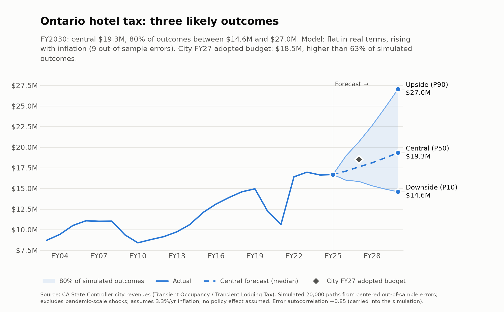
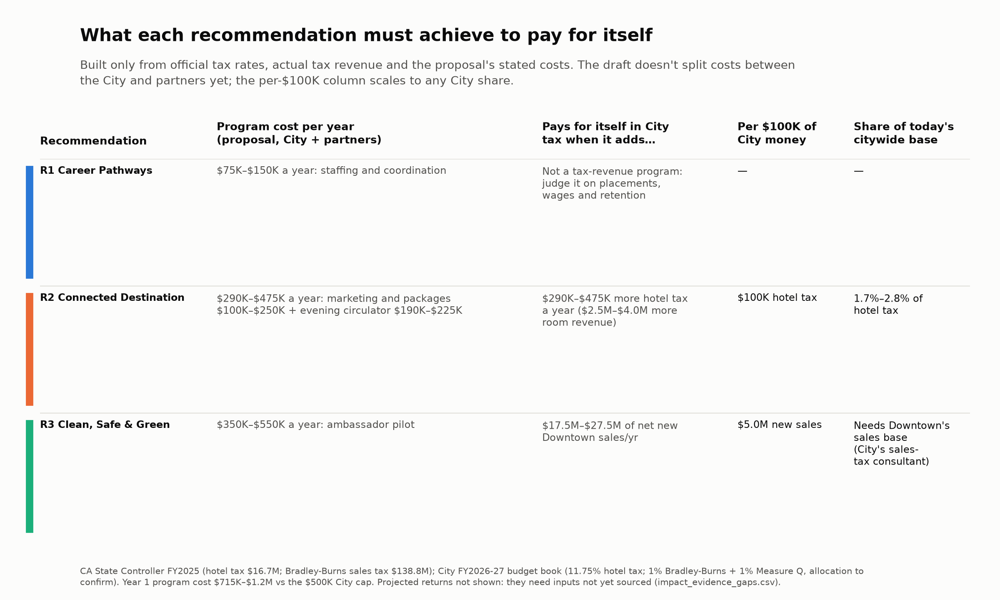

# Conclusions

[← Methods](methods.md) · [README](../README.md)

> **Key:** **R1** Career Pathways & Employer Consortium · **R2** Connected Destination Economy (visitor
> marketing, Stay +1 packages, evening circulator) · **R3** Clean, Safe & Green Districts (Downtown ambassador
> pilot). Full descriptions: [Background](background.md#the-recommendations-being-tested). R4 (international
> and employer attraction) is not in the current proposal.

> **What this page reports.** Only results built from sourced inputs: the status-quo forecasts (fitted to State
> Controller data and tested on years the model hadn't seen) and the break-even targets (official tax rates,
> actual tax revenue and the proposal's stated costs). It does **not** report a projected return for any
> recommendation, because each one still depends on inputs that are team estimates rather than data; §4 lists
> them. Regenerate every figure with `pnpm nx run ontario-forecast:report`.

## 1. If nothing changes (status-quo baseline)

| Target | Selected model | Out-of-sample result |
|---|---|---|
| Hotel tax (TOT) | **"Same as last year"** (naive) | The best candidate (transportation & warehousing jobs) beat naive by only 2% over all test years and 7% outside COVID, on 8 test years. That's under the 10% margin a model needs to be trusted |
| Sales tax | **"Same as last year"** (naive) | No candidate beat naive both with and without COVID |

**What this means:** with about 20 yearly data points, no indicator reliably predicts either tax better than
last year's value. The baseline is flat in real terms (growing with inflation), with a range from past errors.

- **Hotel tax, FY2030:** central **$19.3M** (80% of outcomes between $14.6M and $27.0M, nominal).
- **FY27 budget figure ($18.5M):** **higher than 63% of simulated outcomes** (central estimate $17.6M). It's
  on the optimistic side under the status quo. The $18.5M is confirmed in the City's adopted budget, which
  plans for 8.8% growth over the FY26 year-end estimate of $17.0M.
- **Why the range is wide:** hotel-tax forecast errors are strongly correlated year to year (**+0.85**), so a
  good or bad year tends to be followed by another. The simulation carries that forward. The correlation is
  estimated from only 9 years, so treat the width as approximate.

- **Sales tax, FY2030:** central **$164M** ($132M to $202M, nominal). This is the Bradley-Burns 1% only; it
  doesn't include Measure Q.
- **FY27 budget, like for like:** the City budgets **$148.8M** for the Bradley-Burns part. The model's central
  FY27 estimate is $147.4M, so the two agree closely (the budget is higher than 54% of simulated outcomes).

## 2. What each recommendation must achieve to pay for itself

These targets need no estimate of how well a program will work. They say what it would have to produce, in City
tax revenue, to cover its own cost. The proposal states each program's full cost but not how it splits between the
City and partners, so the targets use the full cost, and the last column scales them to any City share.

| | Program cost per year (proposal, City + partners) | Pays for itself in City tax when it adds… | Per $100K of City money | Share of today's citywide base |
|---|---|---|---|---|
| **R1** Career Pathways | $75K–$150K (staffing and coordination) | Not a tax-revenue program: judge it on placements, wages and retention | — | — |
| **R2** Connected Destination | $290K–$475K (marketing and packages $100K–$250K + evening circulator $190K–$225K) | **$290K–$475K more hotel tax a year**, which means $2.5M–$4.0M more hotel room revenue | $100K of hotel tax | 1.7%–2.8% of FY2025 hotel tax ($16.7M) |
| **R3** Clean, Safe & Green | $350K–$550K (ambassador pilot) | **$17.5M–$27.5M of net new Downtown taxable sales a year**, after any sales shifted from elsewhere in Ontario | $5M of new sales | Needs Downtown's sales base, which the City's sales-tax consultant holds |

How these are built:
- **Hotel tax** is 11.75% of room revenue (Municipal Code §3-6.03), so every $1 of hotel tax needs $8.51 of room
  revenue.
- **Sales tax:** the City receives 1% of taxable sales through Bradley-Burns and 1% through Measure Q (budget book
  pp. 14, 64), so every $1 of City revenue needs $50 of new taxable sales made in Ontario. How local sales tax is
  allocated should be confirmed with City Finance (see §6).
- **R2 counts hotel tax only.** Visitors' other spending also earns sales tax, but estimating it needs a
  spend-per-visitor figure that isn't sourced yet. The R2 target is therefore conservative.
- **Annual, steady-state and undiscounted.** These are yearly targets for a program running at full scale.

## 3. Year 1 cost against the $500K cap

The draft launches all three programs in months 3–12, so their Year 1 costs add up:

| | Low | High |
|---|---|---|
| Program cost, all three recommendations (from the program descriptions) | $715K | $1,175K |
| The draft's own budget table (staffing + implementation + marketing) | $450K | $900K |
| **City cap** | **$500K** | **$500K** |

- **The cap holds only if partners pay a stated share.** At the low end partners would need to cover at least
  $215K of Year 1 cost; at the high end, $675K. The draft says costs are shared but doesn't yet say how much
  each partner pays.
- **The two cost figures in the draft don't match.** The ambassador pilot ($350K–$550K) and the circulator
  ($190K–$225K) together come to $540K–$775K, more than the budget table's "program implementation" line
  ($275K–$500K). The table and the program descriptions need reconciling.
- **The circulator has a natural start date.** The City has already budgeted a $120K Internal Circulator Planning
  Study, due December 2026 (budget book pp. 408, 487). Starting the circulator after it reports would take
  $190K–$225K out of Year 1 and let the study set the cost and funding.

## 4. What the model can't estimate yet, and what would let it

A projected return needs every link in the chain to be sourced, for example visitors → share staying overnight →
share taking the Stay +1 offer → extra nights. Those links are currently team estimates, so no return is reported.
`outputs/tables/impact_evidence_gaps.csv` lists every one, with where to source it. The ones that matter most:

| | Unsourced inputs | Who holds the data |
|---|---|---|
| **R3** | Downtown's share of citywide taxable sales; the sales uplift from the program; how much of it is shifted from elsewhere in Ontario | The City's sales-tax consultant; a measured pilot with a comparison district |
| **R2** | Share of visitors staying overnight at each venue; share taking the Stay +1 offer; nights that wouldn't have happened anyway; hotel occupancy; visitor spending per day | Venue and ONT visitor surveys; hotels and the visitors bureau; STR or CoStar; Visit California's county travel report |
| **R1** | Share of hires who live in Ontario; hires that wouldn't have happened anyway; how long placed workers stay; resident spending patterns | Program tracking (participant address and employment at 1, 3 and 5 years); BLS Consumer Expenditure Survey |

What is already sourced: tax rates and revenue (State Controller, City budget), hotel room supply (budget book),
airport passengers (airport authority, FAA), pathway wages (BLS), household size (Census) and internship conversion
rates (NACE national survey).

**On the R3 evidence specifically:** the strongest study we found, of Los Angeles business improvement districts
(Brooks, 2008), shows reductions in serious crime. We found no rigorous evaluation showing that ambassador
programs raise sales. R3's fiscal case therefore can't yet be stated as an expected return, only as the
break-even target above.

## 5. How each recommendation's success should be measured

| | Success = | Measured by | Fiscal test |
|---|---|---|---|
| **R1** | Residents placed in higher-wage local jobs who stay | Paid placements; internship-to-job conversion; starting wage; employment at 6 months; participants still living in Ontario | None: a workforce and equity investment. Moving the live/work share one point takes about 800 more residents working locally (1% of the 79,826 employed residents in the proposal's figures) |
| **R2** | Visitors staying longer and visiting more than one district | Hotel tax against the status-quo range; Stay +1 redemptions; circulator boardings per service hour; cross-district visits | Hotel tax up $100K for every $100K of City money |
| **R3** | People feel safer and stay later, and Downtown sales rise rather than shift | The five measures below, plus district taxable sales | Net new Downtown sales of $5M for every $100K of City money |

### Measuring safety, not just sales

For an entertainment district, how safe people *feel* decides whether they stay later and spend, so the pilot
should track both actual conditions and perception:

| Measure | What to track | Team-proposed target | Why this one |
|---|---|---|---|
| **Perceived safety** | Survey visitors, residents and Downtown businesses before launch, then each year | +10 percentage points saying they feel safe in the pilot area | The mechanism behind any sales gain; the business wave also shows whether safety and homelessness drop down the list of top concerns |
| **Repeat problem locations** | Calls for service at addresses with repeat disorder or public-safety calls | Fewer repeat locations, not just fewer calls | Total calls can rise when more people are out, or when ambassadors report more |
| **Evening foot traffic, alongside incidents** | Evening visitor counts in the district against incident counts | Foot traffic up while incidents stay flat or fall | The clearest sign the district is getting busier and more comfortable; with district taxable sales, it tests the R3 break-even target directly |
| **Clean-up response time** | Time to fix graffiti, litter and maintenance reports | Within 24 hours | Visible disorder drives perception, and this is the part the City controls directly |
| **Service acceptance** | Referrals by outreach or ambassador teams, and how many unhoused people accept shelter, treatment or navigation | Above today's baseline: Ontario Police report 105 acceptances from 380 encampment clean-ups, about 28% (budget book p. 319) | Measures outcomes for people, not just contacts, and answers the businesses' top concern |

Ambassador activity counts and outreach response time are worth reporting as contract performance, but they
measure effort rather than results. Two design points make the measures credible:
- **Take the baseline before launch** (the draft's 0–3 month phase).
- **Compare with a similar district that doesn't get the program**, so citywide trends aren't credited to R3.
  Detecting a 10-point change in perceived safety needs roughly 400 survey responses per wave (at a 50% baseline,
  80% power).

## 6. Data reconciliation

- **Sales tax: reconciled.** The proposal's ~$216.3M is the City budget's "Sales Tax" total for FY27, which has
  three parts: Sales & Use (Bradley-Burns) **$148.8M**, Measure Q **$64.3M** and Prop 172 **$3.2M**. The State
  Controller's ~$139M for FY2025 is the Bradley-Burns part alone, and it matches the budget book's FY2025
  actual to the dollar. Both numbers are right; they measure different things.
- **Measure Q** brought in **$60.8M** in FY2024 and **$61.6M** in FY2025, below the roughly $95M estimated before the 2022 vote. The
  State Controller files it under "Other Taxes – Other".
- **Hotel tax rate: confirmed at 11.75%** (Municipal Code §3-6.03). The model had assumed 11–12%.
- **Hotel revenue per room:** actual hotel tax ($16.7M) ÷ 11.75% ÷ 5,670 rooms ÷ 365 nights = about **$69 per
  available room-night**. Splitting that into an average room rate and occupancy needs occupancy data, which isn't
  public (STR, CoStar or the visitors bureau hold it).
- **Local sales-tax treatment: needs City confirmation.** The model credits the City 2% on in-person spending
  (1% Bradley-Burns plus 1% Measure Q) and 1% on business-to-business sales. How local sales and use tax is
  allocated can depend on where a sale is sourced, delivery, use-tax rules and how a transaction is structured.
  The logic is reasonable, but confirm it with City Finance or its sales-tax consultant before relying on
  precise fiscal figures.
- **Live/work 15.5%:** LODES isn't loaded yet; once it is, the EDA reports which year and job type match.
  The figure shows how few working residents also work in Ontario; on its own it doesn't explain why (see
  [Background](background.md#the-problem)).

## 7. How to strengthen the plan

**R2 Connected Destination**
- **Unbundle the cost.** Its $290K–$475K covers marketing and packages plus the circulator. Only the hotel tax from
  added stays counts toward its target, so pilot the packages first and add the circulator once the City's
  circulator study reports.
- **Share the cost with those who benefit.** Hotels keep the room revenue from every added night; the City keeps
  11.75% of it. For every $100K hotels and venues contribute, the hotel-tax target falls by $100K.
- **Make Phase 1 a measurement.** Record redemptions, nights added and whether the guest would have stayed anyway.
  That turns R2's unsourced inputs into data.

**R3 Clean, Safe & Green**
- **Get Downtown's taxable sales** from the City's sales-tax consultant. It shows whether $17.5M–$27.5M of net new
  sales a year is a small or a large share of Downtown's base.
- **State the City's share.** DOIA already funds a maintenance ambassador program from its property assessment,
  and the City already pays DOIA assessments on its own parcels (budget book p. 100). Building on that is the most
  direct route to a cost share.
- **Present it as the recommendation with a measurable test**, not as the one that pays for itself.

**R1 Career Pathways**
- **Frame it as strategic, not fiscal.** Its value is workforce mobility, talent retention, employer relationships
  and higher wages. Say so explicitly, so the absence of a tax return isn't read as failure.
- **Match the promise to the scale.** At the draft's scale it can credibly promise placements and wage gains; a
  shift in the citywide live/work share would take hundreds of additional local workers.
- **Get preliminary employer and college interest** before submission, to support the intern numbers.

## 8. Priorities before submission

| # | What to get | Who has it | What it settles |
|---|---|---|---|
| 1 | Downtown pilot district's taxable sales | City Finance / the City's sales-tax consultant | Whether R3's break-even target is realistic |
| 2 | The City's share of each program's cost, and partner commitments | The proposal team, DOIA, hotels, venues | Whether Year 1 fits the $500K cap |
| 3 | Reconciled budget table and program costs | The proposal team | The $540K–$775K vs $275K–$500K mismatch |
| 4 | How local sales tax is allocated (the 1% + 1% treatment) | City Finance / the City's sales-tax consultant | Whether the R3 target can be relied on precisely |
| 5 | Circulator cost and funding | The City's Internal Circulator Planning Study (December 2026); Omnitrans; SBCTA | R2's cost and timing |
| 6 | Hotel occupancy and average room rate | The visitors bureau (GOCAL), STR or CoStar | Converts R2's target into a number of nights |
| 7 | LODES check of the 15.5% live/work figure | This pipeline (`ingest-lodes`) | R1's baseline |
| 8 | Preliminary employer and college interest in Career Pathways | Prospective consortium members | Whether R1's scale is realistic |

**Repository gaps to close as well** (tracked in [Sources](sources.md#open-items)): add the proposal document or a
pointer to it, fill the airport-passenger file, and record the original citations for the proposal's figures.

## 9. Summary

1. **If nothing changes,** hotel and sales tax stay roughly flat in real terms. The City's FY27 hotel-tax budget
   ($18.5M) is above 63% of the status-quo outcomes; its Bradley-Burns sales-tax budget ($148.8M) matches the
   forecast closely ($147.4M).
2. **Year 1 cost exceeds the $500K cap unless partners pay a stated share.** The three programs cost $715K–$1.175M
   in Year 1 at the draft's own figures.
3. **Each recommendation has a clear, measurable test.** R2 pays for itself if it adds $100K of hotel tax for every
   $100K of City money. R3 pays for itself if it adds $5M of net new Downtown sales for every $100K. R1 should be
   judged on placements and wages, not tax.
4. **The recommendations do different jobs.** R3 has the most direct link to City revenue, R2 is a visitor-economy
   experiment that depends on partners sharing its cost, and R1 is a workforce and equity investment. Presenting
   them that way is more credible than claiming any of them will pay for itself.
5. **No projected return is reported yet,** because the inputs it needs are team estimates. The priority list in §8
   turns them into data; once a recommendation's inputs are sourced, the model reports its return.

[← Methods](methods.md) · [README](../README.md)
