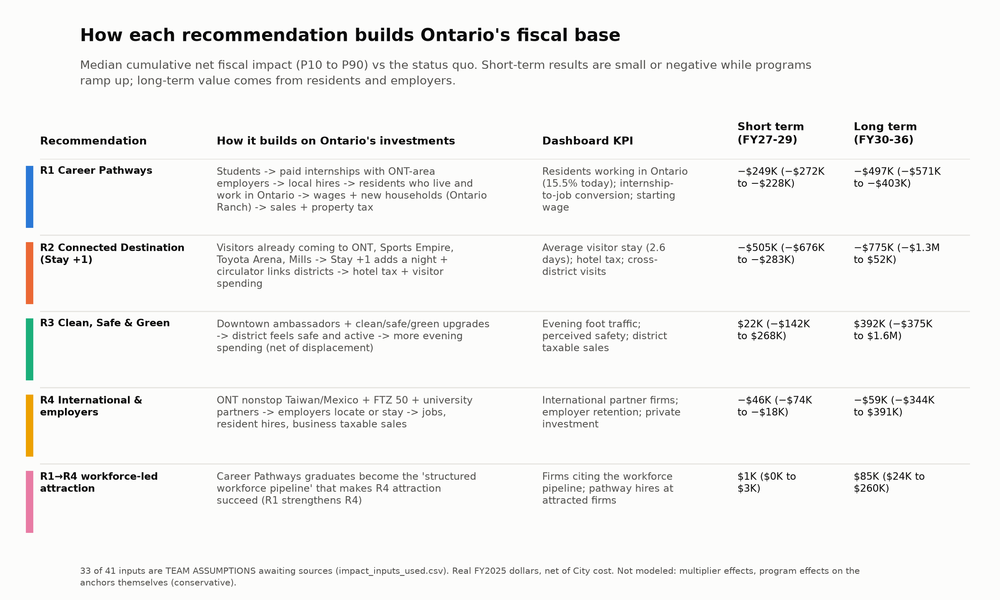
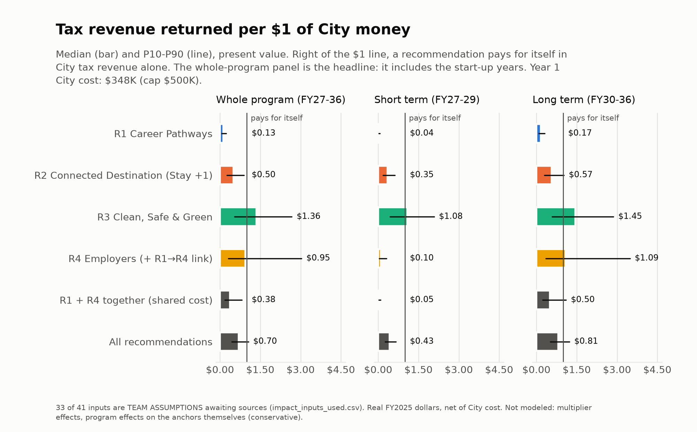
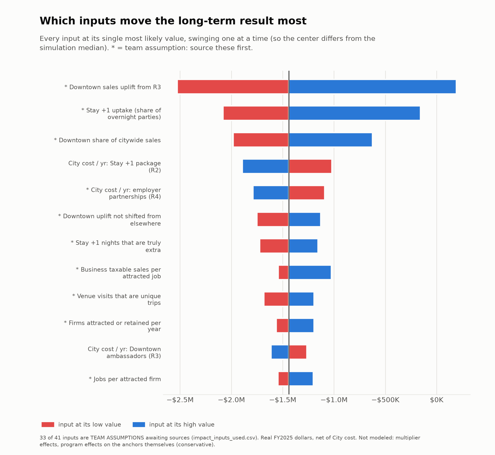

# Conclusions

[← Methods](methods.md) · [README](../README.md)

> **Key:** **R1** Career Pathways (students → paid internships → local jobs) ·
> **R2** Connected Destination / Stay +1 (turn existing visitors into extra hotel nights) ·
> **R3** Clean, Safe & Green Downtown (ambassadors + upgrades) ·
> **R4** International & employer attraction (ONT flights, trade zone) ·
> **R1→R4** Career Pathways workforce helping attract employers. Full descriptions: [Background](background.md#the-recommendations-being-tested).

> **Preliminary.** 33 of 41 impact inputs are team assumptions awaiting sources (see
> `outputs/tables/impact_inputs_used.csv` and [Sources](sources.md)). Trust the direction and the ranking of
> the findings; the dollar figures will move as inputs are sourced. Dollars are real FY2025 dollars. Net
> figures are after City cost and undiscounted; return-on-investment figures are in present value.
> Regenerate every figure with `pnpm nx run ontario-forecast:report`.

## 1. If nothing changes (status-quo baseline)

| Target | Selected model | Out-of-sample result |
|---|---|---|
| Hotel tax (TOT) | **"Same as last year"** (naive) | The best candidate (transportation & warehousing jobs) beat naive by only 2% over all test years and 7% outside COVID, on 8 test years. That's under the 10% margin a model needs to be trusted |
| Sales tax | **"Same as last year"** (naive) | No candidate beat naive both with and without COVID |

**What this means:** with about 20 yearly data points, no indicator reliably predicts either tax better than
last year's value. The baseline is flat in real terms (growing with inflation), with a range from past errors.

- **Hotel tax, FY2030:** central **$19.6M** (80% of outcomes between $16.9M and $23.0M, nominal).
- **FY27 budget figure ($18.5M):** **higher than 70% of simulated outcomes** (central estimate $17.8M). It's
  on the optimistic side under the status quo. The $18.5M is confirmed in the City's adopted budget, which
  plans for 8.8% growth over the FY26 year-end estimate of $17.0M.
- **Caveat:** hotel-tax forecast errors are strongly correlated year to year (**+0.85**). The simulation treats
  them as independent, so the ranges shown are **too narrow**.

- **Sales tax, FY2030:** central **$164M** ($132M to $202M, nominal). This is the Bradley-Burns 1% only; it
  doesn't include Measure Q.
- **FY27 budget, like for like:** the City budgets **$148.8M** for the Bradley-Burns part. The model's central
  FY27 estimate is $147.4M, so the two agree closely (the budget is higher than 54% of simulated outcomes).

## 2. What each recommendation adds

| Recommendation | Short term FY27–29 (median net) | Long term FY30–36 (median net, P10 to P90) |
|---|---|---|
| R1 Career Pathways | −$249K | −$497K (−$571K to −$403K) |
| R2 Connected Destination (Stay +1) | −$505K | −$775K (−$1.3M to **+$52K**) |
| R3 Clean, Safe & Green | **+$22K** | **+$392K** (−$375K to **+$1.6M**) |
| R4 International & employers | −$46K | −$59K (−$344K to **+$391K**) |
| R1→R4 workforce-led attraction | +$1K | +$85K (+$24K to +$260K) |
| **All recommendations** | **−$755K** (−$1.0M to −$437K) | **−$669K** (−$1.8M to **+$850K**) |

**People (FY2036):** about **+118 residents working in Ontario** (P10–P90: 68–197) and **+145 residents**
(77–262). The resident figure assumes housing is available for them (see [Methods](methods.md#b7-known-limitations)).

## 3. Cost and return on investment

The model includes the City's cost for each recommendation (proposal §6). The headline covers the **whole
program, FY27–36, in present value**, so the start-up years count (`outputs/tables/impact_roi.csv`):

| | Tax revenue per $1 of City money (P10–P90) | Chance it pays for itself | City cost / yr | **Break-even City cost / yr** | Reading |
|---|---|---|---|---|---|
| R1 Career Pathways | **$0.13** ($0.07–$0.23) | 0% | $75K | **$9K** | An enabling investment; its value is workforce and residents, not tax |
| R2 Stay +1 | **$0.50** ($0.25–$0.89) | 6% | $227K | **$112K** | Returns about half its cost at 2% uptake; needs roughly 4% uptake or half the City share to break even |
| R3 Clean, Safe & Green | **$1.36** ($0.54–$2.67) | 68% | $106K | **$144K** | The only recommendation that pays for itself in the median case, but it rests on two unsourced inputs |
| R4 + R1→R4 link | **$0.95** ($0.31–$3.03) | 47% | $42K | **$38K** | About break-even, and only because R1's cost isn't counted here |
| R1 + R4 together | **$0.38** ($0.18–$0.81) | 5% | $109K | **$41K** | The fair test of the workforce-to-employer pair: both costs, all revenue |
| **All** | **$0.70** ($0.44–$1.06) | 13% | $431K | **$300K** | — |

Annual costs are present-value averages, so they read lower than the proposal's nominal budget lines.

How returns mature, all recommendations: FY27–29 **$0.43** per $1 · FY30–36 **$0.81** per $1.

- **Year 1 City cost** is about **$348K** (R1 + R2 start in FY27; R3 and R4 start later). That's **within the
  proposal's $500K cap**.
- **"Limited investment" answer:** the break-even column is the most the City could put in each year and still
  be repaid in its own tax revenue. Above it, the City share must be justified by non-fiscal results
  (residents, safety, employer retention) or covered by partners, as the proposal already plans.

## 4. What the City's investments contribute

Long term (FY30–36), gross: **Downtown** carries R3 (~$1.3M), the largest single contribution. **ONT** adds
~$0.4M of Stay +1 revenue and ~$0.9M including international employer effects; it's still the most valuable
venue for Stay +1. **Ontario Ranch** captures the property-tax side of R1/R4 residency (~$0.1M). The Convention
Center (no visitor count yet) and the West Valley Connector (enabling infrastructure) aren't quantified yet.

## 5. What drives the answer

The top inputs, in order:
1. Downtown sales uplift from R3
2. Stay +1 uptake
3. Downtown share of citywide sales
4. R2 City cost
5. R4 City cost

The first three are team assumptions. **The result for R3, now the strongest recommendation, depends almost
entirely on inputs 1 and 3.** Sourcing them (district sales data from the City's sales-tax consultant, and
evaluations of comparable ambassador programs) matters more than anything else.

## 6. How the model judges each recommendation's success

| | Success = | Measured by (dashboard KPI) | Model verdict now |
|---|---|---|---|
| R1 | More residents in higher-wage local jobs than the LODES status-quo band | Residents working in Ontario; conversion; starting wage | **Strategic, not fiscal.** At ~100 interns/yr it adds ~0.15 pt to 15.5%; a 1-point rise needs ~800 more local resident workers |
| R2 | Hotel tax above the status-quo band; longer stays | Hotel tax; average stay; cross-district visits | **Doesn't pay for itself at 2% uptake** ($0.50 per $1). Adds under 1% to hotel tax by FY2036. Needs ~4% uptake or a smaller City share |
| R3 | District sales up, not just shifted | District taxable sales; foot traffic; perceived safety | **Best fiscal case** ($1.36 per $1, 68% chance of payback), pending sourced Downtown inputs |
| R4 | Firms attracted or retained because of the program | Partner firms; employer retention | **About break-even with the R1 link** ($0.95); $0.38 once R1's cost is included |
| R1→R4 | Employers citing the workforce pipeline | Firms citing the pipeline; pathway hires at those firms | Positive but small (~$85K long term) |

## 7. Data reconciliation

- **Sales tax: reconciled.** The proposal's ~$216.3M is the City budget's "Sales Tax" total for FY27, which has
  three parts: Sales & Use (Bradley-Burns) **$148.8M**, Measure Q **$64.3M** and Prop 172 **$3.2M**. The State
  Controller's ~$139M for FY2025 is the Bradley-Burns part alone, and it matches the budget book's FY2025
  actual to the dollar. Both numbers are right; they measure different things.
- **Measure Q** brought in **$60.8M** in FY2024 and **$61.6M** in FY2025, below the roughly $95M estimated before the 2022 vote. The
  State Controller files it under "Other Taxes – Other".
- **Hotel tax rate: confirmed at 11.75%** (Municipal Code §3-6.03). The model had assumed 11–12%.
- **Live/work 15.5%:** LODES isn't loaded yet; once it is, the EDA reports which year and job type match.

## 8. Summary

1. **The plan is affordable and well structured.** It builds on assets Ontario already funds, stays under the
   Year 1 cap, expands only on results, and every KPI maps to a measurable model input.
2. **In tax revenue alone, it doesn't pay for itself:** about **$0.70 back per $1 of City money** over the whole
   program (a 13% chance of full payback). Its case rests on residents, workforce and partner cost-sharing.
3. **The ranking changed after correcting the model.** **R3 (Downtown) is now the strongest fiscal case**,
   because Downtown spending earns the City 2%, not 1%. **R2 (Stay +1) is weaker than first reported**, because
   the airport's passenger count had been counted twice. **R4 no longer "pays for itself"** once R1's cost is
   counted alongside it.
4. **To make it fiscally self-supporting:**
   - lead with R3, and source its two key inputs before committing beyond the pilot
   - cap R2's City share near ~$112K/yr, or set a go/no-go at ~4% Stay +1 uptake
   - keep R1's City cost to coordination only and have employers fund the rest
5. **Next step:** source the top five inputs and rerun. The pipeline regenerates every number and chart in
   this document.

[← Methods](methods.md) · [README](../README.md)
