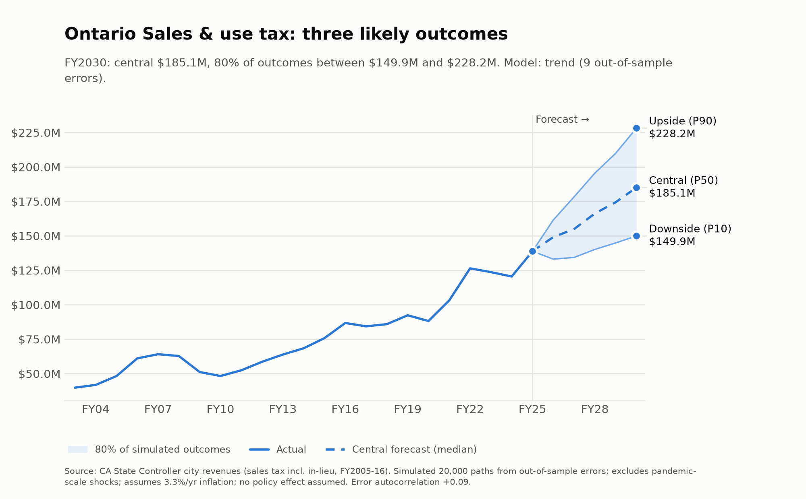
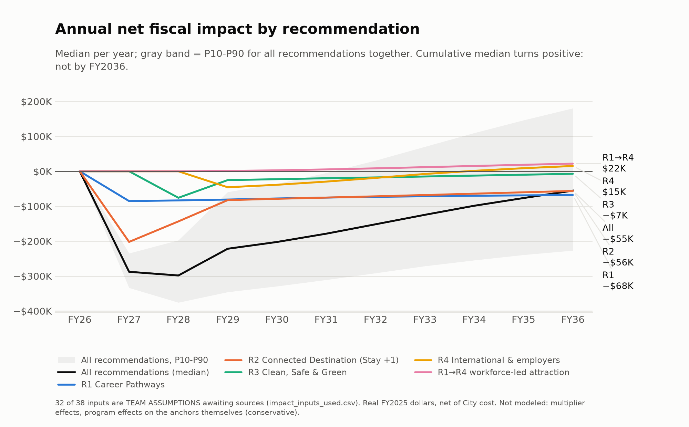
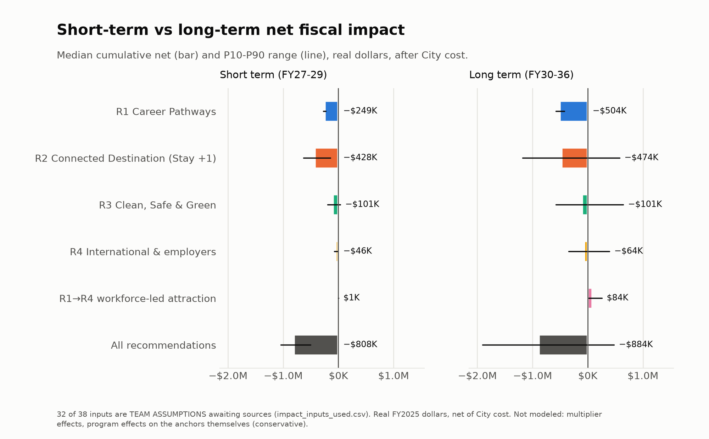
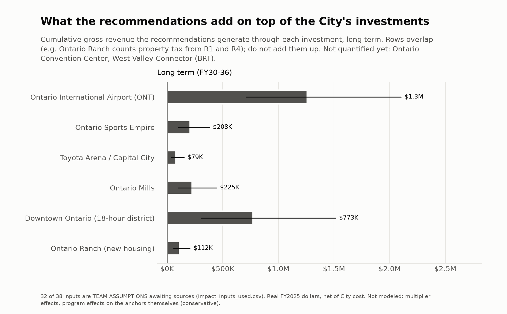

# Conclusions

[← Methods](methods.md) · [README](../README.md)

> **Key:** **R1** Career Pathways (students → paid internships → local jobs) ·
> **R2** Connected Destination / Stay +1 (turn existing visitors into extra hotel nights) ·
> **R3** Clean, Safe & Green Downtown (ambassadors + upgrades) ·
> **R4** International & employer attraction (ONT flights, trade zone) ·
> **R1→R4** Career Pathways workforce helping attract employers. Full descriptions: [Background](background.md#the-recommendations-being-tested).

> **Preliminary.** 32 of 38 impact inputs are team assumptions awaiting sources (see
> `outputs/tables/impact_inputs_used.csv`). Trust the direction and the ranking of the findings; the dollar
> figures will move as inputs are sourced. All dollars are real FY2025 dollars, net of City cost, undiscounted.
> Regenerate every figure with `pnpm nx run ontario-forecast:report`.

## 1. If nothing changes (status-quo baseline)

| Target | Selected model | Out-of-sample result |
|---|---|---|
| Hotel tax (TOT) | Lag-1 growth of **transportation & warehousing jobs** (MSA) | Beats "same as last year" by ~2% over all test years and **~12% outside COVID** (8 test years) |
| Sales tax | **"Same as last year"** (naive) | No candidate beat naive both with and without COVID. Sales tax follows its own momentum more than the regional economy |

- **Hotel tax, FY2030:** central **$19.4M** (80% of outcomes between $17.1M and $22.9M, nominal).
- **FY27 budget figure ($18.5M):** **higher than 77% of simulated outcomes.** It's an optimistic budget
  assumption under the status quo, so the proposal should say it depends on growth beyond the trend.
- **Caveat:** hotel-tax forecast errors are positively correlated year to year (**+0.65**). The simulation treats
  them as independent, so the ranges shown are somewhat **too narrow**.

## 2. What each recommendation adds

| Recommendation | Short term FY27–29 (median net) | Long term FY30–36 (median net, P10 to P90) |
|---|---|---|
| R1 Career Pathways | −$249K | −$504K (−$574K to −$420K) |
| R2 Connected Destination (Stay +1) | −$428K | −$474K (−$1.2M to **+$576K**) |
| R3 Clean, Safe & Green | −$101K | −$101K (−$576K to **+$642K**) |
| R4 International & employers | −$46K | −$64K (−$348K to **+$393K**) |
| **R1→R4 workforce-led attraction** | **+$1K** | **+$84K (+$23K to +$256K)** |
| **All recommendations** | **−$808K** (−$1.0M to −$502K) | **−$884K** (−$1.9M to **+$475K**) |

**People (FY2036):** about **+117 residents working in Ontario** (P10–P90: 68–198) and **+145 residents**
(77–262).

## 3. Cost and return on investment

The model includes the City's cost for each recommendation (proposal §6). Medians, FY30–36
(`outputs/tables/impact_roi.csv`):

| | Tax revenue per $1 of City money (P10–P90) | Chance it pays for itself | City cost / yr (proposal) | **Break-even City cost / yr** | Reading |
|---|---|---|---|---|---|
| R1 Career Pathways | **$0.16** ($0.09–$0.29) | 0% | $86K | **$14K** | An enabling investment; its value is workforce and residents, not tax |
| R2 Stay +1 | **$0.74** ($0.37–$1.33) | 27% | $261K | **$193K** | Largest dollar return and biggest upside; pays for itself with ~26% less City share or ~3.4% uptake |
| R3 Clean, Safe & Green | **$0.88** ($0.35–$1.75) | 42% | $125K | **$110K** | Close to break-even; one more partner contribution closes the gap |
| R4 + R1→R4 link | **$1.11** ($0.35–$3.59) | 55% | $50K | **$52K** | Pays for itself in the median case, *because* R1 supplies the workforce |
| **All** | **$0.76** ($0.49–$1.13) | 20% | $523K | **$397K** | — |

Short term (FY27–29), per $1: R1 $0.03 · R2 $0.45 · R3 $0.60 · R4 $0.10 · All $0.40. Returns grow as programs mature.

- **Year 1 City cost** ≈ **$348K** (R1 + R2 start in FY27; R3 and R4 start later). That's **within the proposal's
  $500K cap**.
- **"Limited investment" answer:** the break-even column is the most the City could put in each year and still
  be repaid in its own tax revenue. Above it, the City share must be justified by non-fiscal results
  (residents, safety, employer retention) or covered by partners, as the proposal already plans.
- Exact figures for every group, including the probability each pays for itself, are in `outputs/tables/impact_roi.csv`.

## 4. What the City's investments contribute

**ONT is the single most valuable anchor:** ~$0.8M of long-term Stay +1 revenue, and $1.3M including
international employer effects. **Downtown** carries R3 (~$0.8M gross). **Ontario Ranch** captures the
property-tax side of R1/R4 residency (~$0.1M). The Convention Center (no visitor count yet) and the West Valley
Connector (enabling infrastructure) aren't quantified yet.

## 5. What drives the answer

The top inputs, in order:
1. Stay +1 uptake
2. Downtown sales uplift
3. R2 City cost
4. Downtown share of citywide sales
5. R2 additionality (extra nights that wouldn't have happened anyway)

All but the R2 cost are team assumptions. **Sourcing these five matters more than any other input.**

## 6. How the model judges each recommendation's success

| | Success = | Measured by (dashboard KPI) | Model verdict now |
|---|---|---|---|
| R1 | More residents in higher-wage local jobs than the LODES status-quo band | Residents working in Ontario; conversion; starting wage | **Strategic, not fiscal.** At ~100 interns/yr it adds ~0.15 pt to 15.5%; a 1-point rise needs ~800 more local resident workers |
| R2 | Hotel tax above the status-quo band; longer stays | Hotel tax; average stay; cross-district visits | **Most promising financially** if Phase 1 shows uptake ≥ ~3–3.5% |
| R3 | District sales up, not just shifted | District taxable sales; foot traffic; perceived safety | **Near break-even;** its main value (safety, retention) isn't in dollars |
| R4 | Firms attracted or retained because of the program | Partner firms; employer retention | **Pays for itself with R1** ($1.11 per $1); weak without it |
| R1→R4 | Employers citing the workforce pipeline | Firms citing the pipeline; pathway hires at those firms | **Positive in every scenario** |

## 7. Data reconciliation

- **Sales tax:** the proposal cites ~$216.3M (FY27 budget); State Controller FY2025 actuals are ~$139M. The
  definitions likely differ. Confirm with the City budget before publishing either number next to the other.
- **Live/work 15.5%:** LODES isn't loaded yet; once it is, the EDA reports which year and job type match.

## 8. Summary

1. **The plan is well designed.** It builds on assets Ontario already funds, stays under the Year 1 cap, expands
   only on results, and every KPI maps to a measurable model input.
2. **In tax revenue alone, it doesn't pay for itself yet:** about **$0.76 back per $1 of City money** in the
   median case (a 20% chance of full payback). Its case rests on residents, workforce and partner cost-sharing.
3. **Best combination:** **R2 + R3** as the near-term destination core (largest revenue, built on ONT, Sports
   Empire and Downtown), with **R1 run lean and employer-funded as the engine for R4.** R4 + the R1→R4 link is
   the only group that pays for itself in the median case ($1.11 per $1), and the R1→R4 link alone is positive
   in every scenario.
4. **To make it fiscally self-supporting:**
   - cap R2's City share near ~$193K/yr, or set a go/no-go at ~3.5% Stay +1 uptake
   - have DOIA and owners cover about $15K more of R3 each year
   - keep R1's City cost to coordination only
5. **Next step:** source the five highest-impact inputs and rerun. The pipeline regenerates every number
   and chart in this document.

[← Methods](methods.md) · [README](../README.md)
