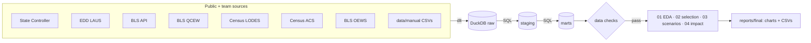

# Methods

[← Decisions](decisions.md) · [README](../README.md) · Next: [Conclusions →](conclusions.md)

Part A is the **data engineering** that produces clean, fiscal-year-aligned tables. Part B is the
**data science**: the status-quo baseline, then the impact method for each recommendation.

---

## Part A: Data engineering

### A1. Pipeline

Orchestration: Nx runs `ingest → transform → eda/select → scenarios/impact → report`.
`e2e` = lint + tests, then a fresh pull, then `report`.

### A2. Ingestion (`src/ontario_forecast/ingest/`)

| Resource | Source / method | Notes |
|---|---|---|
| `sco_city_revenue_lines` | Socrata API through dlt `RESTClient` + `OffsetPaginator` | Ontario + 10 peers, all revenue lines, FY2003+ |
| `laus_city_monthly` | data.ca.gov CKAN → streamed CSV | Filtered to the 11 cities while streaming |
| `bls_observations` | BLS API v2 (POST, chunked by series and year window) | Total nonfarm, leisure & hospitality, and transport & warehousing jobs; MSA unemployment; CPI-LA; CPI lodging. Preliminary values flagged |
| `qcew_county_annual` | BLS QCEW open-data CSV | San Bernardino County, total + NAICS sectors, private ownership |
| `oews_msa_occupations` | BLS API (OE series) | 14 occupations mapped to the proposal's career pathways |
| `lodes_ontario_flows` | Census LODES 8 OD (main + aux), **aggregated inside DuckDB over HTTPS** | One row per year; incremental, so loaded years are skipped |
| `acs_place` | Census API (key) | B08008, B08303, B15003, B19013 for Ontario + the county |
| `manual_<file>` | Every `data/manual/*.csv` | Team-entered values, each with a source column |

All API keys come from environment variables or `.dlt/secrets.toml`, which is never committed.

### A3. Transformation (`transform/sql/`)

- **Parameter tables:** COVID years, ACS vintages, BLS series IDs and proposal fallbacks are written from
  `config.py` into `staging.*` tables, so the SQL never hard-codes them.
- **Staging:** one cleaned, typed table per source.
  - `city_tax_fy`: the hotel-tax rename is joined, the triple flip is added back, and only General Revenues lines are kept.
  - `laus_city_month`, `bls_month`: monthly series.
  - `lodes_ontario_cy`: live/work counts and shares.
  - `acs_place`, `oews_msa`, `city_budget`.
- **Marts:**
  - `ontario_fy_panel` is the modeling table. It holds fiscal-year averages that require all 12 months, real
    dollars, log-growth columns, and a COVID flag.
  - `city_tax_fy` covers the peer cities.
  - `msa_occupation_wages`, `acs_place_of_work` (with Census margin-of-error formulas) and `acs_vintage_change`
    (non-overlapping vintages only, with 90% significance) hold the survey data.
  - `headline_metrics` takes the official value first and the proposal figure only as a flagged fallback.

### A4. Data quality (`transform/checks.py`)

Each check is a query that returns the rows breaking a rule. **Errors stop the export**; warnings are printed.

| Errors | Warnings |
|---|---|
| Unique city × fiscal year; non-negative revenue; TOT and sales tax present every year; consecutive fiscal years; no fiscal year with more than 12 months; LODES shares in [0, 1]; ACS shares in [0, 1]; positive wages | Missing deflator; real TOT growth over ±60%; LODES year missing its out-of-state file; proposal fallbacks still in use; official vs proposal difference over 5%; suppressed OEWS medians |

### A5. Testing and reproducibility

- **39 pytest tests:**
  - statsmodels/scipy wrappers
  - SQL run on hand-made tables
  - LODES aggregation
  - dlt resource construction
  - backtest and lookahead checks
  - scenario math
  - every impact mechanism, run on the real input files
- **Reproducibility:** `uv.lock` and `pnpm-lock.yaml` lock dependencies, and fixed random seeds make every simulation repeatable.

---

## Part B: Data science

### B1. Exploratory analysis (`analysis/01_eda.py`)

1. **Sample size per variable:** about 20 annual points, which caps model complexity.
2. **Definitional breaks:** before/after the triple-flip correction.
3. **Nominal vs real dollars.**
4. **Levels vs growth:** shows how a shared trend creates a false correlation.
5. **Stationarity tests:** ADF and KPSS from statsmodels, used as supporting evidence because they're weak at n≈20.
6. **COVID weight:** how much of the total variation the pandemic years account for.
7. **Peer cities:** real hotel tax per capita, indexed.
8. **Live/work share:** the trend, and which LODES year matches the proposal's 15.5%.
9. **County pay by sector.**
10. **OEWS wages vs the proposal, and the ACS cross-check.**

### B2. Baseline forecast (`analysis/02_variable_selection.py`)

**Target:** real log-growth $g_t = \ln(R_t) - \ln(R_{t-1})$ for hotel tax and for sales tax.

**Six candidates named in advance, lag 1:**
- leisure & hospitality jobs (MSA)
- nonfarm jobs (MSA)
- transport & warehousing jobs (MSA)
- city employment (LAUS)
- hotel prices (CPI lodging)
- change in the MSA unemployment rate

**Steps:**
1. **Screening (descriptive only):** Pearson and Spearman correlations with confidence intervals, and
   Holm-adjusted p-values. Done both with and without COVID years.
2. **Overlap between candidates:** variance inflation factors (VIF).
3. **Expanding-window backtest:** at each year *t*, the model is fit only on years before *t*, with COVID-affected
   rows excluded from fitting. It predicts year *t*, and errors are converted to dollars using the known prior-year level.
4. **Fair comparison:** each model is compared with "same as last year" **on its own available years**, giving
   `rel = MAE / naive MAE`. A model needs at least 5 test years outside COVID to be eligible.
5. **Selection:** a model must beat naive both with and without COVID. Among those, pick the simplest within 5%
   of the best. Otherwise naive is used.
6. **Saved model:** fitted with statsmodels OLS and stored as JSON (coefficients plus out-of-sample errors),
   so the deployed model is numpy only.

### B3. Status-quo scenarios (`analysis/03_scenarios.py`)

$$g^{(s)}_{T+h} = \mu_h + e^{(s)}, \qquad e^{(s)} \sim \text{resample(out-of-sample errors)}$$

$$R^{(s)}_{T+h} = R_T \cdot \exp\Big(\sum_{k \le h} g^{(s)}_{T+k}\Big)$$

- **Simulation:** 20,000 simulated futures with a fixed seed. P10/P50/P90 are taken per year.
- **Model types:** AR(1) runs recursively. A lag-1 driver uses its last observed value in year 1 and its
  historical average afterwards.
- **Live/work share:** simulated on the logit scale, so shares stay between 0 and 1.

### B4. Recommendation impact model (`src/ontario_forecast/impact.py`)

**General method:**
- **Inputs:** every input has a triangular (low, likely, high) range from `impact_assumptions.csv` and a status
  (official, proposal or assumption).
- **Simulation:** 20,000 joint draws, combined with the baseline sales-tax simulation.
- **Phase ramps:** each recommendation is 0 before its start year and rises linearly to 1 at full scale
  (`impact_phases.csv`, from proposal §5).
- **Outputs:** real FY2025 dollars, per recommendation and channel (hotel, sales, property tax), net of City cost.

Notation: $r_t$ = phase ramp, $\tau$ = 1% Bradley-Burns local sales-tax rate,
$S(x)_t = S_{t-1}(1-a) + x_t$ = a cumulative total with yearly attrition $a$.

#### R1 Career Pathways

$$\text{hires}_t = I \cdot r_t \cdot c \cdot \alpha_1 \cdot \rho_1$$

*I* = interns per year at full scale, *c* = share converted to jobs, $\alpha_1$ = share of hires that wouldn't
have happened anyway, $\rho_1$ = share of hires who live in Ontario.

- **Residents working in Ontario:** $W^{R1}_t = S(\text{hires})_t$
- **Sales tax:** $W_t \cdot \text{wage} \cdot \text{taxable share} \cdot \text{local capture} \cdot \tau$, where
  wage = the OEWS range across pathway occupations (official).
- **Residency:** households = $W_t \cdot$ share who are new or retained residents. These add property tax, plus
  taxable spending by the other household members.
- **Success metric:** added residents working locally, compared with the LODES status-quo share.

#### R2 Connected Destination (Stay +1)

For each anchor *k* (ONT, Mills, Toyota Arena, Sports Empire):

$$\text{nights}_{k,t} = V_k (1+\gamma)^t \cdot o_k \cdot d \,/\, p \cdot u \cdot \alpha_2 \cdot r_t$$

$V_k$ = visitors, $\gamma$ = growth in visits, $o_k$ = overnight share, *d* = share of unique trips,
*p* = people per room, *u* = Stay +1 uptake, $\alpha_2$ = share of extra nights that wouldn't have happened anyway.

- **Hotel tax:** nights × average room rate × TOT rate.
- **Sales tax:** nights × *p* × daily visitor spending × $\tau$.
- **Leverage by investment:** revenue is reported per anchor (`impact_stay1_by_anchor.csv`).
- **Success metric:** hotel tax with vs without Stay +1, and average stay.

#### R3 Clean, Safe & Green

$$\Delta\text{ST}_t = \text{baseline sales tax}_t \cdot \text{downtown share} \cdot \text{uplift} \cdot \alpha_3 \cdot r_t$$

$\alpha_3$ = share of the uplift not shifted from elsewhere in Ontario. The baseline comes from the B3 simulation.

- **Success metric:** district taxable sales, foot traffic and perceived safety. The last two are dashboard KPIs, not modeled in dollars.

#### R4 International & employers, and the R1→R4 synergy

- **Jobs:** $\text{jobs}_t = S(F \cdot J \cdot \alpha_4 \cdot r_t)$, with *F* = firms per year and *J* = jobs per firm.
  Resident workers = jobs × resident share.
- **Revenue:** sales tax from resident wages, plus business taxable sales per job × $\tau$, plus residency effects.
- **Synergy:** extra firms per year = $\sigma \cdot W^{R1}_{t-1}/100$ once R4 is active. This is the proposal's
  "structured workforce pipeline" claim, reported as a **separate line** so it can be judged alone.

### B5. Investment leverage and sensitivity

- **Leverage** (`investment_leverage`): `city_investments.csv` maps each City investment to the parts of the model
  that measure it (an anchor, a recommendation, or a revenue channel). Uncountable ones, such as the
  Convention Center and the West Valley Connector, are listed as not modeled rather than given a number.
- **Sensitivity** (one input at a time): every input at its likely value, then each swung to its low and high.
  Inputs are ranked by their effect on the long-term cumulative net. This ranking sets the sourcing priority.

### B6. Known limitations

- 32 of 38 impact inputs are team assumptions, and the dollar figures depend on them.
- Resampling forecast errors independently ignores year-to-year correlation in errors. About 10 out-of-sample
  errors make the ranges coarse.
- Picking the best of about 9 models on the same years makes the winner's error slightly optimistic.
- Not modeled: multiplier effects, the program's effect on venue attendance itself, and dollar values for safety and quality of life.

Next: [Conclusions →](conclusions.md)
